# Learn NestJS 🐱

<div align="center">

[](https://opensource.org/licenses/MIT)
[](https://nestjs.com/)
[](https://github.com/TheLearningHubOrg/learn-nestjs/actions/workflows/ci.yml)
[](https://github.com/TheLearningHubOrg/learn-nestjs/releases)
[](https://www.typescriptlang.org/)
[](https://docs.nestjs.com/techniques/performance)

**From your first `nest new` to staff-level NestJS architecture: dependency injection, the request pipeline, persistence, security, microservices and production operations.**  
Modules, providers and DI scopes, middleware, guards, pipes, interceptors and filters, Prisma and TypeORM, JWT and CASL, CQRS, Kafka and NATS transports, WebSockets, BullMQ, Fastify, observability and the NestJS 12 ESM toolchain.

[Getting Started](#1-stage-1-setup-project-anatomy--bootstrap) • [DI & Modules](#2-stage-2-modules-controllers-providers--dependency-injection) • [Request Pipeline](#3-stage-3-the-request-pipeline-middleware-guards-pipes-interceptors--filters) • [Data Layer](#4-stage-4-data-layer-prisma-typeorm-migrations--transactions) • [Security & Testing](#5-stage-5-security-authentication-authorization--testing) • [Production](#6-stage-6-real-time-queues-performance--deployment) • [Interview Prep](#7-stage-7-staff-nestjs-backend-engineer-interview-handbook--cheatsheet)

<br/>

<a href="https://www.buymeacoffee.com/manthanank">
  
</a>

</div>

> **Language used in this guide: TypeScript.** NestJS is written in TypeScript and its whole programming model (decorators, constructor injection resolved from `emitDecoratorMetadata`, DTO classes that double as validation schemas) depends on TypeScript's compiler features. Plain JavaScript is supported through Babel but loses type-based injection, so every example, the starter project and its tests are TypeScript, run with Vitest and linted with oxlint, the defaults of the NestJS 12 CLI.

---

## 🗺️ 7-Stage Pedagogical Roadmap


| Stage | Focus Domain | Core Concepts & Engineering Outcomes |
| :--- | :--- | :--- |
| **Stage 1** | **Setup, Project Anatomy & Bootstrap** | `nest new`, the ESM vs CommonJS choice, `nest-cli.json`, `tsconfig` decorator flags, `NestFactory.create()`, `app.listen(port, '0.0.0.0')`, `reflect-metadata` and `design:paramtypes`. Outcome: run, build and containerise the starter API. |
| **Stage 2** | **Modules, Controllers, Providers & DI** | `@Module` imports/exports, `@Controller` routing on Express 5, `useClass` / `useValue` / `useFactory` / `useExisting`, abstract-class and `Symbol` tokens, `Scope.REQUEST` cost, `forwardRef()`, `ConfigurableModuleBuilder`, `@nestjs/config` `registerAs`, lifecycle hooks, `Test.createTestingModule().overrideProvider()`. |
| **Stage 3** | **The Request Pipeline** | Middleware, `CanActivate` guards with `Reflector.createDecorator()`, `ValidationPipe` (`whitelist`, `forbidNonWhitelisted`, `transform`), `StandardSchemaValidationPipe`, RxJS interceptors, RFC 9457 exception filters, `createParamDecorator`, `ArgumentsHost`, `APP_*` tokens vs `useGlobal*()`, Supertest e2e. |
| **Stage 4** | **Data Layer** | Prisma service lifecycle, TypeORM repositories, migrations in CI, interactive transactions, unit of work, optimistic locking, connection pooling. |
| **Stage 5** | **Security, Auth & Testing** | Passport JWT strategy, CASL abilities (ABAC), `@nestjs/throttler`, `useSecurityHeaders()`, `enableCsrfProtection()`, secrets handling, unit vs integration vs e2e test layers. |
| **Stage 6** | **Real-time, Queues, Performance & Deployment** | Socket.IO gateways with the Redis adapter, BullMQ producers and `WorkerHost` processors, the Fastify adapter, structured logging (`ConsoleLogger({ json: true })`, Pino), graceful shutdown, multi-stage Docker. |
| **Masterclasses** | **DI internals, CQRS, microservices, NestJS 12 toolchain, flagship blueprint** | Scanner/injector internals, `@nestjs/cqrs` commands, events and sagas, hybrid apps with Kafka/NATS, Standard Schema and ESM migration, an end-to-end order service. |
| **Stage 7** | **Staff Interview Handbook** | Interview Q&As grouped by core concepts, internals, architecture and debugging scenarios, plus a one-page cheatsheet. |

---

## 🆕 NestJS Versions, What's New & Migration

### V.1 Release Timeline

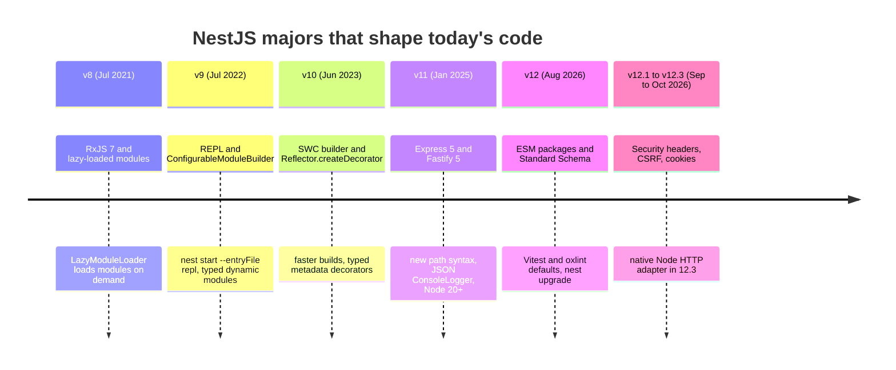

### V.2 Compatibility Matrix

| NestJS | Released | Support status (Nov 2026) | Node.js | HTTP adapters | Default test runner / linter | Notes |
| --- | --- | --- | --- | --- | --- | --- |
| **12.x** | 27 Aug 2026 | Current stable (12.3.x) | 20.19+ or 22.12+ (24 LTS recommended) | Express 5.x, Fastify 5.x, native Node (12.3+) | Vitest + oxlint (ESM projects), Jest (CommonJS projects) | Packages ship as ESM; CommonJS apps keep working through `require(esm)`. |
| **11.x** | 16 Jan 2025 | Maintenance: 11.2.x still receives patch releases | 20+ | Express 5.x, Fastify 5.x | Jest + ESLint 9 | First release on Express 5; `@nestjs/config` 4 and `@nestjs/cache-manager` 3 had breaking changes. |
| **10.x** | 15 Jun 2023 | End of life | 16+ | Express 4.x, Fastify 4.x | Jest + ESLint 8 | Added the SWC builder and `Reflector.createDecorator()`. |
| **9.x** | 8 Jul 2022 | End of life | 12+ | Express 4.x, Fastify 4.x | Jest | Added the REPL and `ConfigurableModuleBuilder`. |

Stay on the current major or the one before it. After a new major ships, the previous one receives patch releases for a limited window only (11.2.8 shipped in October 2026, two months after 12.0).

### V.3 What's New in NestJS 12

#### ESM packages and an ESM-first CLI

Every `@nestjs/*` package now ships as ES modules. `nest new` asks whether to scaffold a CommonJS or an ESM project, and the ESM template uses `"type": "module"`, `module: "nodenext"`, top-level `await` in `main.ts`, and relative imports that end in `.js`.

```typescript
// Before (v11, CommonJS template)
import { NestFactory } from '@nestjs/core';
import { AppModule } from './app.module';

async function bootstrap() {
  const app = await NestFactory.create(AppModule);
  await app.listen(process.env.PORT ?? 3000);
}
bootstrap();
```

```typescript
// After (v12, ESM template; this repo's src/main.ts adds security headers and shutdown hooks)
import { NestFactory } from '@nestjs/core';
import { AppModule } from './app.module.js'; // the compiled file's name, not the .ts source

const app = await NestFactory.create(AppModule);
await app.listen(Number(process.env.PORT ?? 8080), '0.0.0.0');
```

#### Standard Schema validation and serialization

`@Body()`, `@Query()`, `@Param()` and `@RawBody()` accept `{ schema }`, any object that implements the Standard Schema interface (Zod 4, Valibot, ArkType). `StandardSchemaValidationPipe` validates against it, and `StandardSchemaSerializerInterceptor` validates outgoing responses. `class-validator` DTOs remain fully supported.

```typescript
// Before: a DTO class validated by ValidationPipe
import { Body, Controller, Post } from '@nestjs/common';
import { IsString, MaxLength } from 'class-validator';

class CreateTaskDto {
  @IsString()
  @MaxLength(120)
  title: string;
}

@Controller('tasks')
export class TasksController {
  @Post()
  create(@Body() dto: CreateTaskDto) {
    return dto;
  }
}
```

```typescript
// After: an existing Zod schema, no class needed
import { Body, Controller, Post, StandardSchemaValidationPipe, UsePipes } from '@nestjs/common';
import { z } from 'zod';

const createTask = z.object({ title: z.string().trim().min(1).max(120) });
type CreateTask = z.infer<typeof createTask>;

@Controller('tasks')
@UsePipes(new StandardSchemaValidationPipe()) // or app.useGlobalPipes(...) in main.ts
export class TasksController {
  @Post()
  create(@Body({ schema: createTask }) body: CreateTask) {
    return body;
  }
}
```

#### Machine-readable error codes

`HttpExceptionOptions` takes an `errorCode` that ends up in the response body, so clients branch on a stable string instead of parsing messages. The starter's `TasksService` uses it.

```typescript
// Before
throw new NotFoundException(`Task ${id} not found`);
// After
throw new NotFoundException(`Task ${id} not found`, { errorCode: 'TASK_NOT_FOUND' });
```

#### Route conflict diagnostics

Routes are matched in declaration order, so `@Get(':id')` declared before `@Get('me')` silently swallows `/me`. Two opt-in options report or fix this:

```typescript
const app = await NestFactory.create(AppModule, {
  routeConflictPolicy: { duplicate: 'error', shadow: 'warn' },
  routeResolutionStrategy: 'specificity', // static segments win over parameters
});
```

#### Structured logging params

`ConsoleLogger` now treats plain objects after the message as fields of the same record. In JSON mode they nest under `params`.

```typescript
// Before (v11): two separate log lines
logger.log('Task created', { id: 7 });
// After (v12): one record, {"message":"Task created","params":{"id":7},...} in JSON mode
logger.log('Task created', { id: 7 });
```

#### Built-in security headers, CSRF protection and cookies (12.1)

`app.useSecurityHeaders()` sets the same headers as helmet 8's defaults and removes `X-Powered-By`; `app.enableCsrfProtection()` adds adapter-agnostic CSRF checks. Both work on Express and Fastify, so a helmet dependency is no longer required.

```typescript
// Before
import helmet from 'helmet';
app.use(helmet());
// After (this repo's src/main.ts)
app.useSecurityHeaders();
```

#### New CLI commands and tooling

`nest upgrade` migrates a v11 project (dependency bumps, `nest-cli.json` options, GraphQL `playground` to `graphiql`, the NATS package swap). Rspack replaces webpack as the monorepo bundler (`--builder rspack`), oxlint replaces ESLint and Vitest replaces Jest in new ESM projects. `@nestjs/platform-node` (12.3) is a native `node:http` adapter with no Express or Fastify dependency.

### V.4 Migration Guide (11 → 12)

```bash
# 1. Node first: v12 refuses to run on Node < 20.19 or on the 21.x line.
node --version            # want v22.12+ or v24.x

# 2. Upgrade the global CLI, which ships the upgrade command.
npm i -g @nestjs/cli@latest

# 3. Preview, then apply. It bumps every @nestjs/* package together and rewrites config.
nest upgrade --dry-run
nest upgrade

# 4. Reinstall and run the whole suite.
rm -rf node_modules package-lock.json && npm install
npm run build && npm test
```

What `nest upgrade` deliberately leaves to you:

| Area | Manual step |
| --- | --- |
| ESM | Optional. To switch: add `"type": "module"`, set `module`/`moduleResolution` to `nodenext`, add `.js` to relative imports, replace `__dirname` with `import.meta.dirname`. |
| Tests | Jest keeps working for CommonJS. Moving to Vitest: replace `jest.fn()` with `vi.fn()`, add `globals: true`, delete `ts-jest`. |
| Lint | ESLint keeps working. oxlint is optional; `oxlint --type-aware` needs `oxlint-tsgolint`. |
| Custom pipes | `ArgumentMetadata` is generic now; fix signatures the compiler flags. |
| Lifecycle hooks | Hooks run by hierarchy level; re-check code that relied on sibling ordering in `onModuleInit` / `onModuleDestroy`. |
| Config validation | Joi schemas need Joi 18+ and library settings under `validationOptions.libraryOptions`. |

Coming from v10: first apply the v11 changes in V.5 (Express 5 paths, Node 20, `@nestjs/config` 4, `cache-manager` 6), then run `nest upgrade`.

### V.5 Deprecations & Breaking Changes

| Version | Deprecated / removed | Replacement | What breaks and how to fix it |
| --- | --- | --- | --- |
| 12.0 | CommonJS-only package builds | ESM packages (`require(esm)` keeps CJS apps working) | Custom bundler or test setups that `require()` deep paths may fail; use public entry points. |
| 12.0 | Node 18, 20.0-20.18, 21.x, 22.0-22.11 | Node 22.12+ or 24 LTS | `nest upgrade` and the packages refuse older runtimes. |
| 12.0 | `nats` package | `@nats-io/transport-node` | NATS payloads are JSON strings; custom deserializers receive the full message (`msg.json()`). |
| 12.0 | `subscriptions-transport-ws` | `graphql-ws` | Wire-incompatible; update clients together with the server. |
| 12.0 | GraphQL `playground` option | `graphiql` | Rename the option. |
| 12.0 | Webpack builder (`--webpack`) | `--builder rspack` | Deprecated, still works; migrate monorepo builds. |
| 12.0 | `ConsoleLogger` printing extra objects as separate records | Structured params (default on) | Set `structuredParams: false` to keep old output. |
| 12.2 | `@EventPattern()` handlers replying to `send()` (TCP, Redis, NATS, MQTT, RMQ) | `@MessagePattern()` for request/response | Logs a deprecation warning now; will stop replying in the next major. |
| 12.2 | `ValidationPipe` errors carrying `target` | `validationError.target: true` if you need it | An `exceptionFactory` reading `error.target` now gets `undefined`. |
| 11.0 | Express 4 path syntax (`*`, `:id?`) | `{*splat}`, `{/:id}` | Nest converts legacy patterns and warns; update `forRoutes('*')` and optional params. |
| 11.0 | Node 16 and 18 | Node 20+ | Startup fails on old runtimes. |
| 11.0 | `cache-manager` 5 stores | Keyv-based stores (`@keyv/redis`) | Rewrite `CacheModule.register({ store })` config. |
| 11.0 | Promises in a module's `exports` | Export the provider token | Was never reliably supported; now rejected. |

---

## 📋 Table of Contents

- [🆕 NestJS Versions, What's New & Migration](#-nestjs-versions-whats-new--migration)
- [1. Stage 1: Setup, Project Anatomy & Bootstrap](#1-stage-1-setup-project-anatomy--bootstrap)
  - [1.1 What NestJS Is and the Problem It Solves](#11-what-nestjs-is-and-the-problem-it-solves)
  - [1.2 Installation & First Run](#12-installation--first-run)
  - [1.3 Project Anatomy: What Every File Does](#13-project-anatomy-what-every-file-does)
  - [1.4 Line-by-Line: Bootstrapping with NestFactory](#14-line-by-line-bootstrapping-with-nestfactory)
  - [1.5 The Request Lifecycle at a Glance](#15-the-request-lifecycle-at-a-glance)
  - [1.6 ESM vs CommonJS in NestJS 12](#16-esm-vs-commonjs-in-nestjs-12)
  - [1.7 The Nest CLI: Generators, Builders and Watch Mode](#17-the-nest-cli-generators-builders-and-watch-mode)
  - [1.8 Decorators and Metadata: How Nest Reads Your Classes](#18-decorators-and-metadata-how-nest-reads-your-classes)
  - [1.9 Pitfalls](#19-pitfalls)
  - [1.10 Best Practices](#110-best-practices)
  - [1.11 Hands-on Exercise](#111-hands-on-exercise)
- [2. Stage 2: Modules, Controllers, Providers & Dependency Injection](#2-stage-2-modules-controllers-providers--dependency-injection)
  - [2.1 Modules and the Module Graph](#21-modules-and-the-module-graph)
  - [2.2 Controllers and Routing](#22-controllers-and-routing)
  - [2.3 Providers and the IoC Container](#23-providers-and-the-ioc-container)
  - [2.4 Custom Providers: useClass, useValue, useFactory, useExisting and Tokens](#24-custom-providers-useclass-usevalue-usefactory-useexisting-and-tokens)
  - [2.5 Provider Scopes and Memory Footprint](#25-provider-scopes-and-memory-footprint)
  - [2.6 Resolving Circular Dependencies via `forwardRef()`](#26-resolving-circular-dependencies-via-forwardref)
  - [2.7 Dynamic Modules: forRoot, forRootAsync and ConfigurableModuleBuilder](#27-dynamic-modules-forroot-forrootasync-and-configurablemodulebuilder)
  - [2.8 Configuration with @nestjs/config](#28-configuration-with-nestjsconfig)
  - [2.9 Lifecycle Hooks](#29-lifecycle-hooks)
  - [2.10 Testing Providers with Test.createTestingModule](#210-testing-providers-with-testcreatetestingmodule)
  - [2.11 Pitfalls](#211-pitfalls)
  - [2.12 Best Practices](#212-best-practices)
  - [2.13 Hands-on Exercise](#213-hands-on-exercise)
- [3. Stage 3: The Request Pipeline: Middleware, Guards, Pipes, Interceptors & Filters](#3-stage-3-the-request-pipeline-middleware-guards-pipes-interceptors--filters)
  - [3.1 The Execution Chain Sequence](#31-the-execution-chain-sequence)
  - [3.2 Middleware](#32-middleware)
  - [3.3 Guards and Reflector Metadata](#33-guards-and-reflector-metadata)
  - [3.4 Pipes and Validation](#34-pipes-and-validation)
  - [3.5 Interceptors](#35-interceptors)
  - [3.6 Exception Filters and Problem Details (RFC 9457)](#36-exception-filters-and-problem-details-rfc-9457)
  - [3.7 Custom Decorators](#37-custom-decorators)
  - [3.8 ExecutionContext and ArgumentsHost Across Protocols](#38-executioncontext-and-argumentshost-across-protocols)
  - [3.9 Binding Scope: Global, Controller, Method and Parameter](#39-binding-scope-global-controller-method-and-parameter)
  - [3.10 End-to-End Testing the Pipeline with Supertest](#310-end-to-end-testing-the-pipeline-with-supertest)
  - [3.11 Pitfalls](#311-pitfalls)
  - [3.12 Best Practices](#312-best-practices)
  - [3.13 Hands-on Exercise](#313-hands-on-exercise)
- [4. Stage 4: Data Layer: Prisma, TypeORM, Migrations & Transactions](#4-stage-4-data-layer-prisma-typeorm-migrations--transactions)
  - [4.1 Prisma Integration via Service Lifecycle Hooks](#41-prisma-integration-via-service-lifecycle-hooks)
  - [4.2 Unit of Work and Transaction Management](#42-unit-of-work-and-transaction-management)
  - [4.3 TypeORM Repositories](#43-typeorm-repositories)
  - [4.4 Prisma vs TypeORM vs Drizzle vs MikroORM](#44-prisma-vs-typeorm-vs-drizzle-vs-mikroorm)
  - [4.5 Pitfalls](#45-pitfalls)
  - [4.6 Best Practices](#46-best-practices)
  - [4.7 Hands-on Exercise](#47-hands-on-exercise)
- [5. Stage 5: Security, Authentication, Authorization & Testing](#5-stage-5-security-authentication-authorization--testing)
  - [5.1 JWT Bearer Strategy with Passport.js](#51-jwt-bearer-strategy-with-passportjs)
  - [5.2 Attribute-Based Access Control (ABAC) with CASL](#52-attribute-based-access-control-abac-with-casl)
  - [5.3 Rate Limiting via `@nestjs/throttler`](#53-rate-limiting-via-nestjsthrottler)
  - [5.4 HTTP Hardening Built into NestJS 12](#54-http-hardening-built-into-nestjs-12)
  - [5.5 Test Layers](#55-test-layers)
  - [5.6 Pitfalls](#56-pitfalls)
  - [5.7 Best Practices](#57-best-practices)
  - [5.8 Hands-on Exercise](#58-hands-on-exercise)
- [6. Stage 6: Real-time, Queues, Performance & Deployment](#6-stage-6-real-time-queues-performance--deployment)
  - [6.1 Scalable WebSockets with Socket.io and the Redis Adapter](#61-scalable-websockets-with-socketio-and-the-redis-adapter)
  - [6.2 High-Performance BullMQ Task Queuing](#62-high-performance-bullmq-task-queuing)
  - [6.3 Switching to the Fastify Adapter](#63-switching-to-the-fastify-adapter)
  - [6.4 Structured JSON Logging](#64-structured-json-logging)
  - [6.5 The Production Container](#65-the-production-container)
  - [6.6 Pitfalls](#66-pitfalls)
  - [6.7 Best Practices](#67-best-practices)
  - [6.8 Hands-on Exercise](#68-hands-on-exercise)
- [M1. Masterclass: Inside the DI Container: Scanner, Injector & Module Graph](#m1-masterclass-inside-the-di-container-scanner-injector--module-graph)
  - [M1.1 How It Works Internally](#m11-how-it-works-internally)
  - [M1.2 Worked Example: Reading the Error Message](#m12-worked-example-reading-the-error-message)
  - [M1.3 Trade-offs: Ways to Get an Instance](#m13-trade-offs-ways-to-get-an-instance)
  - [M1.4 Production Checklist](#m14-production-checklist)
- [M2. Masterclass: Event-Driven Architecture, CQRS & Sagas](#m2-masterclass-event-driven-architecture-cqrs--sagas)
  - [M2.1 How It Works Internally](#m21-how-it-works-internally)
  - [M2.2 Commands](#m22-commands)
  - [M2.3 Sagas with RxJS Operators](#m23-sagas-with-rxjs-operators)
  - [M2.4 Trade-offs](#m24-trade-offs)
  - [M2.5 Production Checklist](#m25-production-checklist)
- [M3. Masterclass: Microservices, Transports & Hybrid Applications](#m3-masterclass-microservices-transports--hybrid-applications)
  - [M3.1 How It Works Internally](#m31-how-it-works-internally)
  - [M3.2 Hybrid Applications (HTTP + Message Consumer)](#m32-hybrid-applications-http--message-consumer)
  - [M3.3 Event Pattern vs Message Pattern](#m33-event-pattern-vs-message-pattern)
  - [M3.4 Transport Trade-offs](#m34-transport-trade-offs)
  - [M3.5 Production Checklist](#m35-production-checklist)
- [M4. Masterclass: The NestJS 12 Toolchain: ESM, Standard Schema, Vitest & oxlint](#m4-masterclass-the-nestjs-12-toolchain-esm-standard-schema-vitest--oxlint)
  - [M4.1 How It Works Internally](#m41-how-it-works-internally)
  - [M4.2 Worked Example](#m42-worked-example)
  - [M4.3 Trade-offs](#m43-trade-offs)
  - [M4.4 Production Checklist](#m44-production-checklist)
- [M5. Masterclass: Flagship Blueprint: Resilient Order Management Service](#m5-masterclass-flagship-blueprint-resilient-order-management-service)
  - [M5.1 How It Works Internally](#m51-how-it-works-internally)
  - [M5.2 Core Controller, DTO and Service](#m52-core-controller-dto-and-service)
  - [M5.3 Trade-offs](#m53-trade-offs)
  - [M5.4 Production Checklist](#m54-production-checklist)
- [7. Stage 7: Staff NestJS Backend Engineer Interview Handbook & Cheatsheet](#7-stage-7-staff-nestjs-backend-engineer-interview-handbook--cheatsheet)
  - [7.1 Core Concepts (Q1-Q10)](#71-core-concepts-q1-q10)
  - [7.2 Internals & Performance (Q11-Q15)](#72-internals--performance-q11-q15)
  - [7.5 Staff Cheatsheet](#75-staff-cheatsheet)
- [🧪 Example Projects](#-example-projects)
- [📝 Cheat Sheets](#-cheat-sheets)
- [📚 Resources](#-resources)
- [🤝 Contributing](#-contributing)
- [📄 License](#-license)
- [🙏 Acknowledgments](#-acknowledgments)
- [🌐 Connect with me](#-connect-with-me)
- [☕ Support](#-support)

---

## 1. Stage 1: Setup, Project Anatomy & Bootstrap

This stage installs the toolchain, walks through every file `nest new` generates and the starter project in this repo, and follows one HTTP request from `NestFactory.create()` to the response. Prerequisites: Node.js 22.12+ (24 LTS recommended), npm, and working knowledge of TypeScript classes and `async`/`await`. Afterwards you can scaffold, run, build, lint, test and containerise a NestJS 12 service.

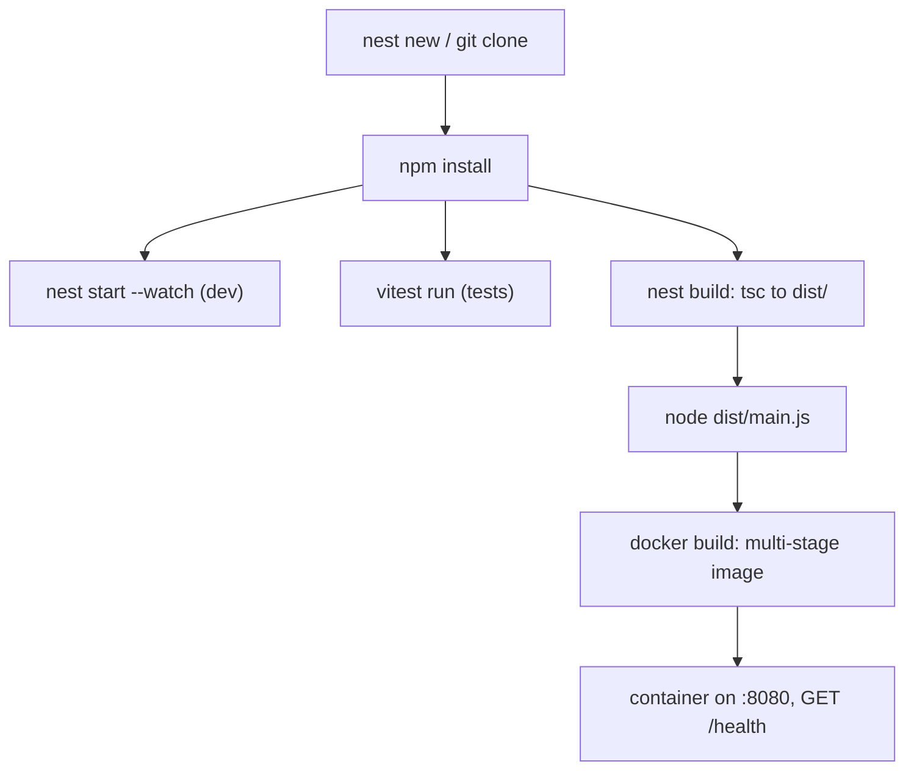

### 1.1 What NestJS Is and the Problem It Solves

Express and Fastify give you a router and a middleware chain, then leave structure to you. Two teams using Express will organise services, configuration, validation and error handling in two different ways, and wiring dependencies by hand (`new OrderService(new PaymentClient(config))`) spreads across the codebase. NestJS sits on top of those servers and adds the missing architecture: a module system, an Inversion of Control (IoC) container that builds and injects your classes, and a fixed request pipeline for cross-cutting concerns.

Enterprise backends built with NestJS rest on five pillars:

1. **Inversion of Control and dependency injection.** Classes declare what they need in their constructor; the container creates them once, in the right order, and hands them out. Swapping a real repository for a fake in a test is a one-line provider override.
2. **A deterministic request pipeline.** Every request passes through middleware, guards, interceptors, pipes, the handler and exception filters in a documented order (Stage 3), so authentication, validation and error formatting each have one obvious home.
3. **Platform independence.** Controllers talk to an `HttpAdapter`, not to Express. The same code runs on Express 5, Fastify 5 or, since 12.3, a native `node:http` adapter.
4. **One transport abstraction for messaging.** `@MessagePattern()` and `@EventPattern()` handlers work across TCP, Redis, NATS, RabbitMQ, Kafka, MQTT and gRPC (Masterclass M3).
5. **RxJS-native composition.** Interceptors receive the handler's result as an `Observable`, so timeouts, retries, caching and response mapping are operators (`timeout`, `retry`, `map`) instead of hand-written promise plumbing.

How NestJS compares with the alternatives:

| Dimension | NestJS on Express | NestJS on Fastify | Raw Express 5 | Raw Fastify 5 | Spring Boot (Java) |
| :--- | :--- | :--- | :--- | :--- | :--- |
| Language & typing | TypeScript, strict available | TypeScript, strict available | JavaScript, optional TS | JavaScript, optional TS | Java / Kotlin |
| Architecture | Opinionated modules + IoC | Opinionated modules + IoC | Unopinionated, flat | Plugin encapsulation | Opinionated IoC |
| Relative throughput | Baseline | Typically well above Express on small JSON payloads | Slightly above NestJS/Express (no framework layer) | Highest of the Node options | High; JVM warm-up matters |
| Dependency injection | Built-in, hierarchical | Built-in, hierarchical | None (manual wiring) | Decorators via plugins | Spring container |
| Microservice transports | Built-in, many | Built-in, many | External libraries | External libraries | Spring Cloud |
| Validation | `ValidationPipe` + class-validator, or Standard Schema | Same, or Fastify JSON Schema | Your own middleware | Built-in Ajv JSON Schema | Bean Validation |
| Testing | `@nestjs/testing` module overrides | Same, plus `app.inject()` | Supertest + manual mocks | `inject()` | `@SpringBootTest` |
| Learning curve | Moderate (Angular-like concepts) | Moderate | Low | Low | Steep |

Benchmarks vary by payload, Node version and hardware, so measure your own workload before you switch adapters for speed (Stage 6). The architectural gains, not raw requests per second, are why teams pick NestJS.

### 1.2 Installation & First Run

NestJS 12 requires Node.js 20.19+ or 22.12+; the 21.x line is rejected. Install the CLI globally or run it through `npx`:

```bash
node --version                  # v22.12.0 or newer, v24.x recommended
npm i -g @nestjs/cli            # or prefix every command with: npx @nestjs/cli
nest --version                  # 12.x

nest new my-api --strict --package-manager npm
# The CLI asks: CommonJS or ESM? Pick ESM for new projects (Vitest + oxlint template).
cd my-api
npm run start:dev               # nest start --watch, recompiles on save
curl http://localhost:3000      # Hello World!
```

To run this repository's starter instead:

```bash
git clone https://github.com/TheLearningHubOrg/learn-nestjs.git
cd learn-nestjs
npm ci                          # exact versions from package-lock.json
API_KEY=dev-key-change-me npm run start:dev
curl -s localhost:8080/health   # {"status":"ok","uptimeSeconds":3}
npm test                        # 17 unit and e2e tests
npm run build && node dist/main.js
```

`nest new` options worth knowing:

| Flag | Effect |
| --- | --- |
| `--strict` | Turns on `strict` in `tsconfig.json`. Use it; retrofitting strictness later is painful. |
| `--package-manager npm\|pnpm\|yarn\|bun` | Skips the prompt. bun is supported from CLI 12. |
| `--skip-git` / `--skip-install` | Useful inside monorepos or CI scaffolding scripts. |
| `--language js` | JavaScript template (Babel). Loses type-based injection; avoid for new work. |
| `--observe` | Wires up the optional `@nestjs/observe` SDK. |

### 1.3 Project Anatomy: What Every File Does

The starter in this repository extends the CLI's ESM template:

```text
learn-nestjs/
├── src/
│   ├── main.ts                         bootstrap: create app, security headers, listen
│   ├── app.module.ts                   root module: imports features, registers global enhancers
│   ├── config/app.config.ts            registerAs('app') namespace + env validation
│   ├── health/                         HealthModule + GET /health (public)
│   ├── tasks/                          feature module: controller, service, repository, DTOs
│   └── common/                         cross-cutting: guard, interceptor, filter, middleware, decorator
├── test/app.e2e-spec.ts                Supertest against the real AppModule
├── nest-cli.json                       CLI config: sourceRoot, builder, deleteOutDir
├── tsconfig.json / tsconfig.build.json compiler flags; build excludes specs and test/
├── vitest.config.ts                    unit + e2e test discovery
├── .oxlintrc.json                      lint rules (no-floating-promises is an error)
├── Dockerfile                          multi-stage image, non-root, port 8080
└── .github/workflows/ci.yml            lint, typecheck, test, build, docker smoke test
```

| File | Role | What happens at runtime |
| :--- | :--- | :--- |
| `package.json` `"type": "module"` | Tells Node to treat `dist/*.js` as ES modules | Without it, `import` statements in `dist/main.js` throw `SyntaxError: Cannot use import statement outside a module`. |
| `tsconfig.json` `experimentalDecorators` | Enables the legacy decorator syntax Nest uses | `@Injectable()`, `@Controller()` compile to calls that attach metadata. |
| `tsconfig.json` `emitDecoratorMetadata` | Emits `design:paramtypes` for decorated classes | The injector reads constructor parameter types from it. Turn it off and injection by type breaks. |
| `tsconfig.json` `module: "nodenext"` | ESM output with Node's resolution rules | Relative imports must name the emitted file: `./app.module.js`. |
| `tsconfig.build.json` | Build-only config extending the base | Excludes `**/*.spec.ts` and `test/` so tests never land in `dist/`. |
| `nest-cli.json` `deleteOutDir` | Cleans `dist/` before each build | Removes stale files from deleted sources, which otherwise keep running. |
| `vitest.config.ts` | Test discovery and globals | `globals: true` provides `describe`/`it`/`expect` without imports, like Jest. |
| `.oxlintrc.json` | Fast Rust linter config | `--type-aware` enables rules such as `no-floating-promises`, which catches a missing `await`. |

### 1.4 Line-by-Line: Bootstrapping with NestFactory

This is `src/main.ts` from the starter:

```typescript
import 'reflect-metadata';
import { Logger } from '@nestjs/common';
import { NestFactory } from '@nestjs/core';
import { AppModule } from './app.module.js';

async function bootstrap(): Promise<void> {
  const app = await NestFactory.create(AppModule);

  // NestJS 12.1+: helmet-equivalent defaults (CSP, HSTS, nosniff, ...) and no X-Powered-By.
  app.useSecurityHeaders();

  // Run OnModuleDestroy / OnApplicationShutdown hooks on SIGTERM (docker stop, Kubernetes).
  app.enableShutdownHooks();

  // Containers need 0.0.0.0; "localhost" would only accept connections from inside the container.
  const port = Number(process.env.PORT ?? 8080);
  await app.listen(port, '0.0.0.0');
  Logger.log(`Listening on http://0.0.0.0:${port}`, 'Bootstrap');
}

await bootstrap();
```

| Line / API | Role | What happens at runtime |
| :--- | :--- | :--- |
| `import 'reflect-metadata'` | Installs the `Reflect.getMetadata` polyfill | Must run before any decorated class is evaluated. `@nestjs/core` imports it too; the explicit import documents the dependency. |
| `NestFactory.create(AppModule)` | Builds the application | Scans the module graph from `AppModule`, instantiates every singleton provider in dependency order, creates the Express adapter and registers routes (the `Mapped {/tasks, POST} route` log lines). |
| `app.useSecurityHeaders()` | Response security headers | Adds CSP, HSTS, `X-Content-Type-Options: nosniff` and friends to every response, including 404s, and strips `X-Powered-By`. |
| `app.enableShutdownHooks()` | Signal handling | Listens for `SIGTERM`/`SIGINT` and runs `onModuleDestroy`, `beforeApplicationShutdown`, `onApplicationShutdown`. Off by default because it adds process listeners. |
| `app.listen(port, '0.0.0.0')` | Starts the HTTP server | Calls `onApplicationBootstrap` hooks, then binds the socket. Binding to `0.0.0.0` makes the container reachable through Docker's port mapping. |
| `await bootstrap()` | Top-level await (ESM only) | An unhandled rejection during startup crashes the process with a non-zero exit code instead of leaving a half-started server. |

`NestFactory.create()` accepts options that change startup behaviour:

```typescript
import { ConsoleLogger } from '@nestjs/common';
import { NestFactory } from '@nestjs/core';
import { AppModule } from './app.module.js';

const app = await NestFactory.create(AppModule, {
  logger: new ConsoleLogger({ json: true }), // one JSON object per line, for log shippers
  bufferLogs: true,     // hold logs until a custom logger is attached with app.useLogger()
  abortOnError: false,  // throw instead of process.exit(1) on bootstrap errors (useful in tests)
  cors: { origin: ['https://app.example.com'] },
});
```

### 1.5 The Request Lifecycle at a Glance

Every HTTP request crosses the same layers. Stage 3 covers each one in depth; for now, learn the order.

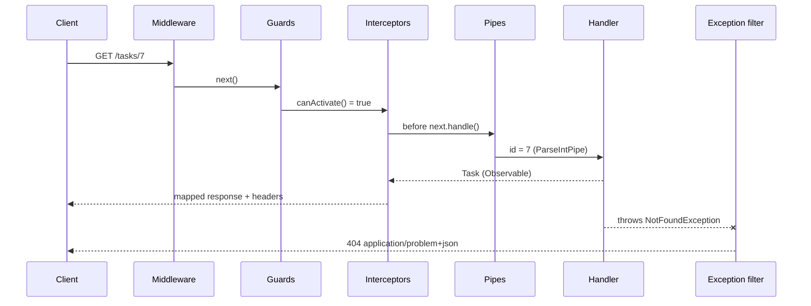

| Layer | Starter file | Typical job |
| --- | --- | --- |
| Middleware | `common/middleware/request-id.middleware.ts` | Correlation IDs, raw body access, legacy Express middleware. |
| Guard | `common/guards/api-key.guard.ts` | Authentication and authorisation: return `true` or throw. |
| Interceptor | `common/interceptors/timing.interceptor.ts` | Timing, logging, caching, response mapping, timeouts. |
| Pipe | global `ValidationPipe`, `ParseIntPipe` | Validate and convert input before the handler sees it. |
| Handler | `tasks/tasks.controller.ts` | Translate HTTP into a service call. No business logic. |
| Filter | `common/filters/problem-details.filter.ts` | Turn exceptions into a consistent error body. |

### 1.6 ESM vs CommonJS in NestJS 12

NestJS 12 packages are ES modules. Your application can still be CommonJS because Node 20.19+/22.12+ can `require()` an ES module synchronously (`require(esm)`), which is why the minimum Node version rose. New projects should pick ESM; the choice changes these things:

| Topic | CommonJS project | ESM project (this repo) |
| --- | --- | --- |
| `package.json` | no `"type"` (or `"commonjs"`) | `"type": "module"` |
| `tsconfig` `module` | `commonjs` | `nodenext` |
| Relative imports | `'./app.module'` | `'./app.module.js'` (the emitted file) |
| Top-level `await` | Not allowed | Allowed in `main.ts` |
| `__dirname`, `require` | Available | Use `import.meta.dirname`, `createRequire()` |
| Default test runner | Jest + ts-jest | Vitest |
| Loading ESM-only libraries | Works on Node 22.12+ via `require(esm)` | Native |

```typescript
// ESM: a path relative to the current file, replacing __dirname.
import { readFile } from 'node:fs/promises';
import { join } from 'node:path';

const templatePath = join(import.meta.dirname, 'templates', 'welcome.html');
export const loadWelcomeTemplate = () => readFile(templatePath, 'utf8');
```

The `.js` extension on a `.ts` import surprises everyone once. TypeScript does not rewrite import paths; it type-checks against `app.module.ts` and leaves the string alone, so the string must already be correct for the compiled output that Node runs.

### 1.7 The Nest CLI: Generators, Builders and Watch Mode

Generators keep naming and wiring consistent. Each one creates the file and registers it in the nearest module.

```bash
nest g resource orders            # module + controller + service + DTOs + specs, asks REST/GraphQL/WS
nest g module payments            # payments/payments.module.ts, added to AppModule.imports
nest g service payments --no-spec # skip the spec file
nest g guard common/guards/roles --flat   # no extra folder
nest g interceptor common/interceptors/logging
nest g filter common/filters/http-exception
nest g decorator common/decorators/roles  # v12 uses Reflector.createDecorator()
nest g resource orders --dry-run  # print what would change, write nothing

nest build                        # tsc by default
nest build --builder swc          # much faster transpile; add --type-check to keep type errors
nest start --watch                # rebuild + restart on change
nest start --debug --watch        # adds --inspect for a debugger
nest info                         # versions of Node, CLI and @nestjs/* packages (paste into bug reports)
```

| Builder | Speed | Type-checks | When to use |
| --- | --- | --- | --- |
| `tsc` (default) | Slowest | Yes | Small and medium apps, CI builds. |
| `swc` | Fastest | Only with `--type-check` | Large apps in watch mode; keep a `tsc --noEmit` step in CI. |
| `rspack` (v12) | Fast, bundles | Through a plugin | Monorepos and single-file deployables; replaces the deprecated webpack builder. |

### 1.8 Decorators and Metadata: How Nest Reads Your Classes

A decorator is a function that runs once, when the class is defined, and records facts about it. Nest decorators do not change behaviour themselves; they write metadata that the framework reads at startup. With `emitDecoratorMetadata` on, TypeScript also writes the constructor's parameter types, which is how the injector knows what to inject.

```typescript
import 'reflect-metadata';
import { Injectable } from '@nestjs/common';

@Injectable()
class Clock {
  now() {
    return new Date();
  }
}

@Injectable()
class Greeter {
  constructor(private readonly clock: Clock) {}
}

// What the injector reads at startup:
console.log(Reflect.getMetadata('design:paramtypes', Greeter)); // [ [class Clock] ]
console.log(Reflect.getMetadata('__injectable__', Greeter));    // true
```

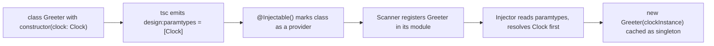

Three consequences follow:

- **Interfaces cannot be tokens.** `constructor(repo: TasksRepository)` works in the starter because `TasksRepository` is an abstract class, which exists at runtime. An `interface` is erased, so the metadata would say `Object` and injection fails. Use an abstract class or an explicit token with `@Inject()` (Stage 2.4).
- **`import type` breaks injection.** A type-only import is erased too. Under `isolatedModules`, TypeScript reports error TS1272 when a decorated signature needs a value import, which is the compiler protecting you.
- **Build tools must emit metadata.** `tsc` and SWC do. Vite 8 (used by Vitest 4 here) honours `emitDecoratorMetadata` through its Oxc transformer, which is why the starter's tests need no extra plugin; older Vitest setups used `unplugin-swc` for the same reason.

### 1.9 Pitfalls

| Pitfall | Symptom | Fix |
| --- | --- | --- |
| Listening on `localhost` inside Docker | Container logs "listening", but `curl` from the host gets `Connection reset by peer` | `app.listen(port, '0.0.0.0')`. |
| Missing `.js` on a relative import in an ESM project | `Error [ERR_MODULE_NOT_FOUND]: Cannot find module '/app/dist/app.module' imported from /app/dist/main.js` | Import `'./app.module.js'`; `module: "nodenext"` makes `tsc` flag this at compile time. |
| `"type": "module"` missing from the runtime image | `SyntaxError: Cannot use import statement outside a module` | Copy `package.json` into the runtime stage (see the Dockerfile). |
| Node too old for v12 | `npm warn EBADENGINE` then crashes loading `@nestjs/core`, or `nest upgrade` refuses to run | Node 22.12+ or 24 LTS; pin it in `engines` and in CI. |
| `emitDecoratorMetadata` off, or a test transformer that drops it | `Nest can't resolve dependencies of the TasksService (?, Symbol(CLOCK))` with `?` at index 0 | Re-enable the flag; use a transformer that emits metadata (tsc, SWC, Vite 8/Oxc). |
| Running `nest start` (a dev workflow) in production | Slow cold start, CLI and TypeScript in the image | Build once, run `node dist/main.js`. |
| Floating promise in `main.ts` (`bootstrap();`) | Startup errors print `UnhandledPromiseRejection` and the exit code depends on Node flags | `await bootstrap()` (ESM) or `bootstrap().catch(...)`; oxlint's `no-floating-promises` catches it. |
| Stale files in `dist/` | A deleted controller still serves routes | Keep `deleteOutDir: true` in `nest-cli.json`. |

### 1.10 Best Practices

- **Choose ESM and `--strict` for new projects**: both are the v12 defaults and both are expensive to adopt later.
- **Read `PORT` from the environment and bind `0.0.0.0`**: the same image then runs locally, in Docker and on any platform that injects a port.
- **Call `enableShutdownHooks()`**: without it, `docker stop` kills the process before database pools and queues close.
- **Keep `main.ts` thin**: register global behaviour as `APP_*` providers in `AppModule` (Stage 3.9) so tests built from the module get it too.
- **Commit `package-lock.json` and use `npm ci`**: identical dependency trees on laptops, CI and Docker.
- **Pin the Node version in three places**: `engines`, CI matrix, Docker base image.
- **Run `tsc --noEmit` in CI even if you build with SWC**: SWC strips types without checking them.

### 1.11 Hands-on Exercise

Add a `GET /version` endpoint that returns `{ "name": "learn-nestjs", "version": "<package.json version>" }` and is reachable without an API key.

1. Generate a controller: `nest g controller version --no-spec`, and add it to `HealthModule`.
2. Read the version with `createRequire(import.meta.url)('../../package.json')` or by reading the file with `node:fs`.
3. Mark the handler `@Public()`.

Expected output:

```bash
$ curl -s localhost:8080/version
{"name":"learn-nestjs","version":"1.0.0"}
```

Solution sketch: the pattern matches `src/health/health.controller.ts`; add a test next to the health assertions in `test/app.e2e-spec.ts`.

[Back to top ⤴️](#-table-of-contents)

---

## 2. Stage 2: Modules, Controllers, Providers & Dependency Injection

This stage covers the building blocks every Nest application is made of: modules that group features, controllers that map HTTP to methods, and providers that the IoC container creates and injects. It assumes Stage 1. Afterwards you can design a module graph, register providers with custom tokens and factories, choose provider scopes deliberately, write reusable dynamic modules, load and validate configuration, and test any provider in isolation.

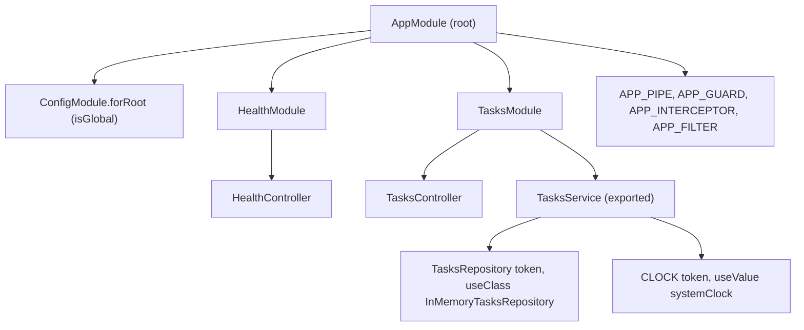

### 2.1 Modules and the Module Graph

A module is a class decorated with `@Module()` that declares four lists. Every application has one root module, and Nest builds a graph from it by following `imports`.

| Property | Meaning | Rule of thumb |
| --- | --- | --- |
| `imports` | Modules whose **exported** providers this module may inject | Import the module, never re-list its providers. |
| `controllers` | Classes that handle requests | Only in the module that owns the routes. |
| `providers` | Classes and values this module's container creates | Private to the module unless exported. |
| `exports` | The subset of providers (or imported modules) other modules may use | Export the narrowest public API. |

Modules are **encapsulated**: a provider is visible inside its own module and in modules that import it, and nowhere else. The starter's `TasksModule` exports `TasksService` but not `TasksRepository`, so another module can call the service but cannot bypass it to reach storage.

```typescript
import { Module } from '@nestjs/common';
import { CLOCK, systemClock } from './clock.js';
import { TasksController } from './tasks.controller.js';
import { InMemoryTasksRepository, TasksRepository } from './tasks.repository.js';
import { TasksService } from './tasks.service.js';

@Module({
  controllers: [TasksController],
  providers: [
    TasksService, // shorthand for { provide: TasksService, useClass: TasksService }
    { provide: TasksRepository, useClass: InMemoryTasksRepository },
    { provide: CLOCK, useValue: systemClock },
  ],
  // Exported so another module that imports TasksModule can inject TasksService.
  exports: [TasksService],
})
export class TasksModule {}
```

Modules are singletons: if `OrdersModule` and `ReportsModule` both import `TasksModule`, they share the same `TasksService` instance.

`@Global()` makes a module's exports injectable everywhere without importing it. It is convenient for infrastructure (configuration, a database client), and a trap for feature code, because dependencies become invisible in the `imports` lists:

```typescript
import { Global, Module } from '@nestjs/common';
import { DatabaseService } from './database.service.js';

@Global() // Makes exported providers available in every module without re-importing
@Module({
  providers: [DatabaseService],
  exports: [DatabaseService],
})
export class CoreDatabaseModule {}
```

`ConfigModule.forRoot({ isGlobal: true })` in the starter is the same idea expressed as a dynamic-module option. Register a global module once, in the root module.

A module can also **re-export** an imported module, which builds a facade: `@Module({ imports: [DatabaseModule, CacheModule], exports: [DatabaseModule, CacheModule] }) export class InfrastructureModule {}` lets feature modules import one thing.

### 2.2 Controllers and Routing

A controller maps routes to methods. The class decorator sets a path prefix, method decorators set the HTTP verb and sub-path, and parameter decorators extract parts of the request.

```typescript
import {
  Body,
  Controller,
  Delete,
  Get,
  HttpCode,
  HttpStatus,
  Param,
  ParseBoolPipe,
  ParseIntPipe,
  Patch,
  Post,
  Query,
} from '@nestjs/common';
import { Public } from '../common/decorators/public.decorator.js';
import { CreateTaskDto } from './dto/create-task.dto.js';
import { UpdateTaskDto } from './dto/update-task.dto.js';
import type { Task } from './task.entity.js';
import { TasksService } from './tasks.service.js';

@Controller('tasks')
export class TasksController {
  constructor(private readonly tasks: TasksService) {}

  @Public()
  @Get()
  findAll(@Query('done', new ParseBoolPipe({ optional: true })) done?: boolean): Promise<Task[]> {
    return this.tasks.findAll(done);
  }

  @Public()
  @Get(':id')
  findOne(@Param('id', ParseIntPipe) id: number): Promise<Task> {
    return this.tasks.findOne(id);
  }

  @Post()
  create(@Body() dto: CreateTaskDto): Promise<Task> {
    return this.tasks.create(dto);
  }

  @Patch(':id')
  update(@Param('id', ParseIntPipe) id: number, @Body() dto: UpdateTaskDto): Promise<Task> {
    return this.tasks.update(id, dto);
  }

  @Delete(':id')
  @HttpCode(HttpStatus.NO_CONTENT)
  remove(@Param('id', ParseIntPipe) id: number): Promise<void> {
    return this.tasks.remove(id);
  }
}
```

| Line / API | Role | What happens at runtime |
| :--- | :--- | :--- |
| `@Controller('tasks')` | Route prefix | All handlers live under `/tasks` (plus any global prefix). |
| `constructor(private readonly tasks: TasksService)` | Constructor injection | The injector passes the `TasksService` singleton when it creates the controller at startup. |
| `@Get(':id')` | Route with a path parameter | `:id` captures one segment as a string. |
| `@Param('id', ParseIntPipe)` | Extract + convert | `'7'` becomes `7`; `'abc'` throws `BadRequestException` before the handler runs. |
| `@Query('done', new ParseBoolPipe({ optional: true }))` | Optional query flag | Missing means `undefined`; `'true'`/`'false'` become booleans; anything else is a 400. |
| `@Body() dto: CreateTaskDto` | Request body | The global `ValidationPipe` uses the `CreateTaskDto` type (from metadata) to validate and instantiate it. |
| `@HttpCode(HttpStatus.NO_CONTENT)` | Status override | `POST` defaults to 201 and everything else to 200; `DELETE` here returns 204 with no body. |
| `return this.tasks.findOne(id)` | Return value | Nest awaits Promises (and subscribes to Observables), then serialises objects as JSON. |

Return values instead of calling `res.json()`. Injecting `@Res()` switches the route into library-specific mode: interceptors no longer see the response, and the code is tied to Express. If you need the response object only to set a header or cookie, use `@Res({ passthrough: true })`, or better, `@Header('Cache-Control', 'no-store')`.

**Route paths on Express 5.** NestJS 11 moved to Express 5, whose router (path-to-regexp 8) changed the wildcard and optional syntax:

| Intent | Express 4 / Nest 10 | Express 5 / Nest 11+ |
| --- | --- | --- |
| Match everything | `'*'` | `'{*splat}'` (named wildcard) |
| Wildcard under a prefix | `'files/*'` | `'files/*path'` |
| Optional segment | `':id?'` | `'{/:id}'` |
| Characters `( ) [ ] ?` in a literal path | Allowed | Must be escaped |

**Route order and shadowing.** Routes match in declaration order. In the controller below, `/users/me` reaches `findOne` with `id = 'me'`, and `ParseIntPipe` turns that into a confusing 400:

```typescript
import { Controller, Get, Param, ParseIntPipe } from '@nestjs/common';

@Controller('users')
export class UsersController {
  @Get(':id')
  findOne(@Param('id', ParseIntPipe) id: number) {
    return { id };
  }

  @Get('me') // never reached: declared after ':id'
  me() {
    return { me: true };
  }
}
```

Declare static routes first, or let NestJS 12 catch it: `NestFactory.create(AppModule, { routeConflictPolicy: { shadow: 'warn' } })` logs the shadowed route at startup, and `routeResolutionStrategy: 'specificity'` makes static segments win regardless of order.

### 2.3 Providers and the IoC Container

A provider is anything the container can create and inject: services, repositories, factories, helpers, plain values. Instead of classes instantiating their own dependencies with `new`, they declare them as constructor parameters and the container resolves them from `design:paramtypes` metadata (Stage 1.8).

```typescript
import { Injectable, Scope } from '@nestjs/common';

export interface AuditLog {
  action: string;
  userId: string;
  timestamp: Date;
}

@Injectable({ scope: Scope.DEFAULT }) // Singleton; DEFAULT is what you get with plain @Injectable()
export class AuditService {
  private readonly logs: AuditLog[] = [];

  record(action: string, userId: string): void {
    this.logs.push({ action, userId, timestamp: new Date() });
  }

  getLogs(): readonly AuditLog[] {
    return this.logs;
  }
}
```

What the container does with a provider, in order:

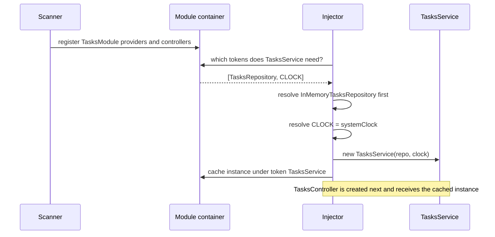

`@Injectable()` is required on any class that has constructor dependencies; it is what makes TypeScript emit `design:paramtypes` for it. A class with no dependencies works without it, but add it anyway so a later constructor change does not break silently.

### 2.4 Custom Providers: useClass, useValue, useFactory, useExisting and Tokens

The `providers` array accepts four provider shapes plus the class shorthand. Each pairs a **token** (`provide`) with a recipe.

| Shape | Recipe | Starter / typical use |
| --- | --- | --- |
| `TasksService` | Shorthand for `useClass: TasksService` | Most services. |
| `{ provide: TasksRepository, useClass: InMemoryTasksRepository }` | Instantiate this class for that token | Ports and adapters; swap per environment. |
| `{ provide: CLOCK, useValue: systemClock }` | Use this exact value | Constants, config objects, test doubles. |
| `{ provide: DB, useFactory: (cfg) => connect(cfg), inject: [ConfigService] }` | Call this (possibly `async`) function | Clients that need configuration or an awaited connection. |
| `{ provide: 'AliasedLogger', useExisting: AppLogger }` | Alias another token | Two names, one instance. |

Tokens can be a class, a `string`, or a `Symbol`. Prefer classes (an abstract class for a port) or `Symbol`s; string tokens collide silently across a large codebase.

The starter uses an abstract class as both the contract and the token, so the service needs no `@Inject()`:

```typescript
import { Injectable } from '@nestjs/common';
import type { Task } from './task.entity.js';

export abstract class TasksRepository {
  abstract findAll(filter?: { done?: boolean }): Promise<Task[]>;
  abstract findById(id: number): Promise<Task | undefined>;
  abstract insert(data: Omit<Task, 'id'>): Promise<Task>;
  abstract update(id: number, patch: Partial<Omit<Task, 'id'>>): Promise<Task | undefined>;
  abstract delete(id: number): Promise<boolean>;
}

@Injectable()
export class InMemoryTasksRepository extends TasksRepository {
  private readonly rows = new Map<number, Task>();
  private nextId = 1;

  async findById(id: number): Promise<Task | undefined> {
    const row = this.rows.get(id);
    return row ? { ...row } : undefined; // copies: callers cannot mutate stored state
  }
  // findAll, insert, update, delete: see src/tasks/tasks.repository.ts
}
```

A function type has no runtime identity, so the clock uses a `Symbol` token and `@Inject()`:

```typescript
// src/tasks/clock.ts
export const CLOCK = Symbol('CLOCK');
export type Clock = () => Date;
export const systemClock: Clock = () => new Date();
```

```typescript
// src/tasks/tasks.service.ts (constructor)
import { Inject, Injectable } from '@nestjs/common';
import { CLOCK, type Clock } from './clock.js';
import { TasksRepository } from './tasks.repository.js';

@Injectable()
export class TasksService {
  constructor(
    // Class token: resolved from the constructor parameter type via emitDecoratorMetadata.
    private readonly repo: TasksRepository,
    // Symbol token: types are erased at runtime, so @Inject() names the token explicitly.
    @Inject(CLOCK) private readonly now: Clock,
  ) {}
}
```

A factory provider for a client that needs configuration and an awaited connection:

```typescript
import { Module } from '@nestjs/common';
import { ConfigService } from '@nestjs/config';
import { createClient, type RedisClientType } from 'redis';

export const REDIS = Symbol('REDIS');

@Module({
  providers: [
    {
      provide: REDIS,
      inject: [ConfigService],
      // Nest awaits async factories before any dependant is created.
      useFactory: async (config: ConfigService): Promise<RedisClientType> => {
        const client = createClient({ url: config.getOrThrow<string>('REDIS_URL') });
        await client.connect();
        return client as RedisClientType;
      },
    },
  ],
  exports: [REDIS],
})
export class RedisModule {}
```

Use `@Optional()` for a dependency that may be absent (`@Optional() @Inject(METRICS) metrics?: Metrics`); without it, a missing provider is a startup error, which is usually what you want.

### 2.5 Provider Scopes and Memory Footprint

NestJS supports three provider scopes:

- **`Scope.DEFAULT` (singleton).** One instance per application, created at startup and shared across all requests. No per-request allocation.
- **`Scope.REQUEST`.** A new instance for every incoming request, garbage-collected when the request completes. It can inject `REQUEST` to read the current request.
- **`Scope.TRANSIENT`.** A dedicated instance for each class that injects it (two consumers get two instances), created when the consumer is created.

> [!WARNING]
> Request scope is "infectious": it bubbles **up** the injection chain. If `TasksController` injects a request-scoped `TenantContext` through `TasksService`, the service and the controller also become request-scoped, so every request now constructs all three. Under heavy traffic, thousands of short-lived objects per second increase GC pressure and tail latency.

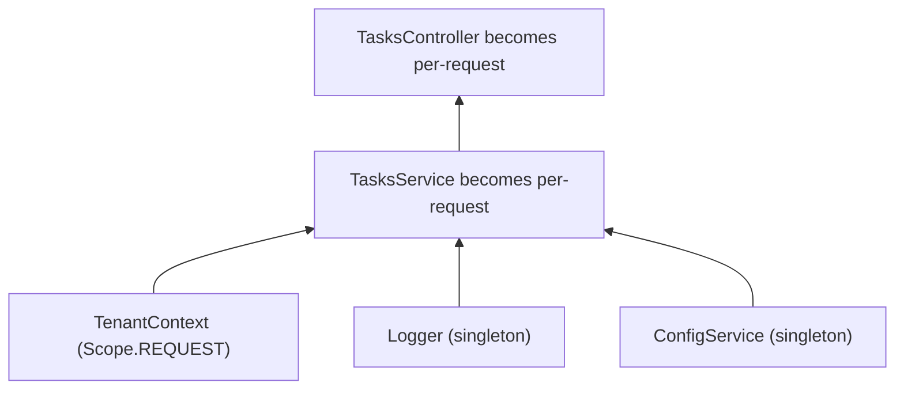

| Need | Avoid | Prefer |
| --- | --- | --- |
| Current user in a service | Request-scoped service that injects `REQUEST` | Pass the user as a method argument from the controller (`@CurrentUser()`, Stage 3.7). |
| Correlation ID in logs | Request-scoped logger | `AsyncLocalStorage` (`nestjs-cls` or a small custom store) populated by middleware. |
| Per-tenant database connection | Request scope for everything | Durable providers: a `ContextIdStrategy` that maps requests to a per-tenant sub-tree, so instances are reused per tenant rather than per request. |
| A stateful helper per consumer | Shared singleton with mutable fields | `Scope.TRANSIENT`. |

Measure before choosing request scope: in practice, two or three request-scoped providers at the root of a hot path can be enough to show up in latency percentiles.

### 2.6 Resolving Circular Dependencies via `forwardRef()`

When `OrderService` injects `PaymentService` and `PaymentService` injects `OrderService`, the injector cannot decide which to build first. At import time one of the classes is also still `undefined` because of the circular `import`. `forwardRef()` defers the reference on both sides:

```typescript
import { Injectable, Inject, forwardRef } from '@nestjs/common';

@Injectable()
export class OrderService {
  constructor(
    @Inject(forwardRef(() => PaymentService))
    private readonly paymentService: PaymentService,
  ) {}
}

@Injectable()
export class PaymentService {
  constructor(
    @Inject(forwardRef(() => OrderService))
    private readonly orderService: OrderService,
  ) {}
}
```

The same applies to modules: `imports: [forwardRef(() => PaymentsModule)]` on both sides. Treat `forwardRef()` as a temporary patch. A cycle means two classes share a responsibility; the durable fixes are:

| Refactor | How |
| --- | --- |
| Extract the shared part | Move what both need into a third provider (for example `PricingService`) that neither depends back on. |
| Invert with events | `PaymentService` emits `payment.captured`; `OrderService` listens. Neither imports the other (`@nestjs/event-emitter` or CQRS events, Masterclass M2). |
| Pass a callback or value | The caller passes what the callee needs as a method argument instead of the callee injecting the caller. |
| Lazy lookup | Inject `ModuleRef` and call `moduleRef.get(OrderService, { strict: false })` inside the method that needs it. |

Symptoms of an undetected cycle: `Nest can't resolve dependencies of the OrderService (?)` where the `?` is the cyclic dependency, or `A circular dependency between modules. Use forwardRef() to avoid it.`

### 2.7 Dynamic Modules: forRoot, forRootAsync and ConfigurableModuleBuilder

A static module always registers the same providers. A **dynamic module** is returned from a static method and can build providers from options, which is how `ConfigModule.forRoot()`, `TypeOrmModule.forRootAsync()` and `JwtModule.register()` work. The naming convention signals intent:

| Method | Convention |
| --- | --- |
| `forRoot(options)` / `forRootAsync()` | Configure once, in the root module; providers are shared app-wide. |
| `register(options)` / `registerAsync()` | Configure per importing module; each import gets its own configuration. |
| `forFeature(entities)` | Add feature-specific providers (repositories) to a module configured by `forRoot`. |

A hand-written dynamic module with synchronous and asynchronous variants:

```typescript
import { DynamicModule, Module, Provider } from '@nestjs/common';

export interface RedisModuleOptions {
  host: string;
  port: number;
  password?: string;
}

export interface RedisAsyncOptions {
  useFactory: (...args: any[]) => Promise<RedisModuleOptions> | RedisModuleOptions;
  inject?: any[];
}

export const REDIS_CLIENT = 'REDIS_CLIENT';

@Module({})
export class RedisModule {
  static forRoot(options: RedisModuleOptions): DynamicModule {
    const clientProvider: Provider = {
      provide: REDIS_CLIENT,
      useValue: new MockRedisClient(options),
    };

    return {
      module: RedisModule,
      providers: [clientProvider],
      exports: [clientProvider],
    };
  }

  static forRootAsync(options: RedisAsyncOptions): DynamicModule {
    const clientProvider: Provider = {
      provide: REDIS_CLIENT,
      useFactory: async (...args: any[]) => {
        const config = await options.useFactory(...args);
        return new MockRedisClient(config);
      },
      inject: options.inject || [],
    };

    return {
      module: RedisModule,
      imports: [],
      providers: [clientProvider],
      exports: [clientProvider],
    };
  }
}

class MockRedisClient {
  constructor(private readonly opts: RedisModuleOptions) {}
  ping() {
    return `Connected to ${this.opts.host}:${this.opts.port}`;
  }
}
```

Writing the async variants (`useFactory`, `useClass`, `useExisting`, `imports`, `inject`) by hand for every module is repetitive and easy to get subtly wrong. `ConfigurableModuleBuilder` generates them, fully typed:

```typescript
// notifier.module-definition.ts
import { ConfigurableModuleBuilder } from '@nestjs/common';

export interface NotifierOptions {
  webhookUrl: string;
  timeoutMs?: number;
}

export const { ConfigurableModuleClass, MODULE_OPTIONS_TOKEN, OPTIONS_TYPE, ASYNC_OPTIONS_TYPE } =
  new ConfigurableModuleBuilder<NotifierOptions>()
    .setClassMethodName('forRoot') // generates forRoot() and forRootAsync()
    .setExtras({ isGlobal: false }, (definition, extras) => ({
      ...definition,
      global: extras.isGlobal,
    }))
    .build();
```

```typescript
// notifier.module.ts
import { Inject, Injectable, Module } from '@nestjs/common';
import {
  ConfigurableModuleClass,
  MODULE_OPTIONS_TOKEN,
  type NotifierOptions,
} from './notifier.module-definition.js';

@Injectable()
export class NotifierService {
  constructor(@Inject(MODULE_OPTIONS_TOKEN) private readonly options: NotifierOptions) {}

  async notify(text: string): Promise<void> {
    await fetch(this.options.webhookUrl, {
      method: 'POST',
      headers: { 'content-type': 'application/json' },
      body: JSON.stringify({ text }),
      signal: AbortSignal.timeout(this.options.timeoutMs ?? 3000),
    });
  }
}

@Module({ providers: [NotifierService], exports: [NotifierService] })
export class NotifierModule extends ConfigurableModuleClass {}
```

```typescript
// usage in AppModule.imports
NotifierModule.forRootAsync({
  inject: [ConfigService],
  useFactory: (config: ConfigService) => ({ webhookUrl: config.getOrThrow('SLACK_WEBHOOK_URL') }),
  isGlobal: true,
});
```

### 2.8 Configuration with @nestjs/config

`@nestjs/config` loads `.env` files and `process.env` into an injectable `ConfigService`. The starter combines three features: a **namespace** created with `registerAs`, a **validation** function that fails startup on bad input, and `isGlobal`.

```typescript
// src/config/app.config.ts
import { registerAs } from '@nestjs/config';

export interface AppConfig {
  port: number;
  apiKey: string | undefined;
}

export const appConfig = registerAs(
  'app',
  (): AppConfig => ({
    port: Number(process.env.PORT ?? 8080),
    apiKey: process.env.API_KEY || undefined,
  }),
);

export function validateEnv(
  env: Record<string, string | undefined>,
): Record<string, string | undefined> {
  if (env.PORT !== undefined) {
    const port = Number(env.PORT);
    if (!Number.isInteger(port) || port < 1 || port > 65535) {
      throw new Error(`PORT must be an integer between 1 and 65535, got "${env.PORT}"`);
    }
  }
  const apiKey = env.API_KEY ?? '';
  if (apiKey.length > 0 && apiKey.length < 8) {
    throw new Error('API_KEY must be at least 8 characters long');
  }
  return env;
}
```

```typescript
// src/app.module.ts (imports)
ConfigModule.forRoot({ isGlobal: true, load: [appConfig], validate: validateEnv });
```

Three ways to read it:

```typescript
import { Inject, Injectable } from '@nestjs/common';
import { ConfigService, type ConfigType } from '@nestjs/config';
import { appConfig } from './config/app.config.js';

@Injectable()
export class Example {
  constructor(
    private readonly config: ConfigService,
    @Inject(appConfig.KEY) private readonly app: ConfigType<typeof appConfig>,
  ) {}

  read() {
    const a = this.config.get<string>('app.apiKey'); // dotted path into the namespace, may be undefined
    const b = this.config.getOrThrow<string>('DATABASE_URL'); // throws if missing
    const c = this.app.port; // fully typed, no string keys
    return { a, b, c };
  }
}
```

In NestJS 12, `validationSchema` accepts any Standard Schema object, so a Zod schema can both validate and coerce:

```typescript
import { ConfigModule } from '@nestjs/config';
import { z } from 'zod';

ConfigModule.forRoot({
  isGlobal: true,
  validationSchema: z.object({
    NODE_ENV: z.enum(['development', 'production', 'test']).default('development'),
    PORT: z.coerce.number().int().min(1).max(65535).default(8080),
    DATABASE_URL: z.url(),
  }),
});
```

| Option | Effect |
| --- | --- |
| `envFilePath: ['.env.local', '.env']` | First file wins per key; real environment variables override both. |
| `ignoreEnvFile: true` | Production containers: read only the real environment. |
| `cache: true` | Memoise `process.env` lookups in `get()`. |
| `expandVariables: true` | Allow `${OTHER_VAR}` inside `.env` values. |
| `load: [fn]` | Register namespaced factories (`registerAs`). |
| `validate` / `validationSchema` | Fail fast at startup on missing or malformed values. |

### 2.9 Lifecycle Hooks

Providers, controllers and modules can implement lifecycle interfaces. Nest calls them in a fixed sequence:

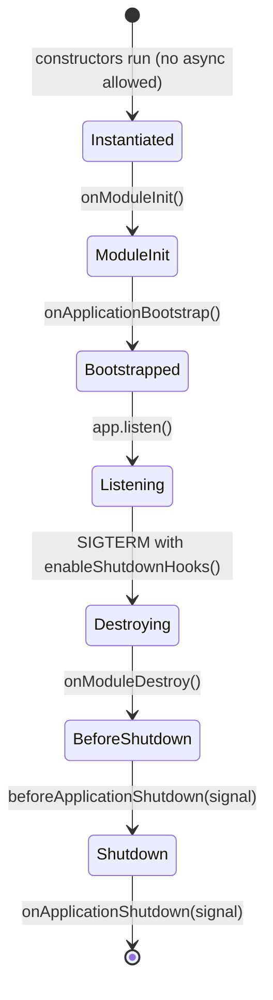

```typescript
import {
  Injectable,
  Logger,
  OnApplicationShutdown,
  OnModuleInit,
} from '@nestjs/common';

@Injectable()
export class CacheWarmer implements OnModuleInit, OnApplicationShutdown {
  private readonly logger = new Logger(CacheWarmer.name);
  private timer?: NodeJS.Timeout;

  async onModuleInit(): Promise<void> {
    // Async work belongs here, not in the constructor. Nest awaits it before listen() completes.
    await this.refresh();
    this.timer = setInterval(() => void this.refresh(), 60_000);
  }

  onApplicationShutdown(signal?: string): void {
    clearInterval(this.timer); // otherwise the interval keeps the process alive
    this.logger.log(`Stopped refresher (${signal ?? 'app.close()'})`);
  }

  private async refresh(): Promise<void> {
    /* load hot keys */
  }
}
```

Ordering rules: hooks for a module's dependencies run before the module's own hooks on the way up, and teardown runs in reverse. NestJS 12 invokes hooks by **hierarchy level** in the module graph, so do not rely on the order of two sibling modules. Shutdown hooks only run when `enableShutdownHooks()` was called or when you call `app.close()` (tests do).

### 2.10 Testing Providers with Test.createTestingModule

`@nestjs/testing` builds a real container from just the providers you list, so a unit test exercises real injection without HTTP. This is `src/tasks/tasks.service.spec.ts`, abridged:

```typescript
import { ConflictException } from '@nestjs/common';
import { Test } from '@nestjs/testing';
import { CLOCK } from './clock.js';
import { InMemoryTasksRepository, TasksRepository } from './tasks.repository.js';
import { TasksService } from './tasks.service.js';

describe('TasksService', () => {
  let service: TasksService;
  let current: Date;

  beforeEach(async () => {
    current = new Date('2026-01-01T09:00:00.000Z');
    const moduleRef = await Test.createTestingModule({
      providers: [
        TasksService,
        { provide: TasksRepository, useClass: InMemoryTasksRepository },
        { provide: CLOCK, useValue: () => current }, // a fake clock makes timestamps assertable
      ],
    }).compile();

    service = moduleRef.get(TasksService);
  });

  it('rejects a duplicate open title, ignoring case', async () => {
    await service.create({ title: 'Ship it' });
    await expect(service.create({ title: 'SHIP IT' })).rejects.toBeInstanceOf(ConflictException);
  });
});
```

To start from a whole feature module and replace one dependency, override it instead of re-listing providers:

```typescript
import { Test } from '@nestjs/testing';
import { CLOCK } from '../src/tasks/clock.js';
import { TasksModule } from '../src/tasks/tasks.module.js';
import { TasksService } from '../src/tasks/tasks.service.js';

const moduleRef = await Test.createTestingModule({ imports: [TasksModule] })
  .overrideProvider(CLOCK)
  .useValue(() => new Date('2030-01-01T00:00:00Z'))
  .compile();

const tasks = moduleRef.get(TasksService);
```

| API | Use it for |
| --- | --- |
| `moduleRef.get(Token)` | Fetch a singleton from the test container. |
| `moduleRef.resolve(Token)` | Fetch a request-scoped or transient provider (returns a Promise). |
| `.overrideProvider(T).useValue(x)` / `.useClass(C)` / `.useFactory({...})` | Swap a dependency, keep the rest of the module real. |
| `.overrideGuard()`, `.overrideInterceptor()`, `.overridePipe()`, `.overrideFilter()` | Disable or fake enhancers in e2e tests. |
| `.overrideModule(Real).useModule(Fake)` | Replace a whole imported module (for example a database module). |
| `vi.fn()` / `vi.spyOn()` | Vitest mocks for collaborators you do not want to run. |

### 2.11 Pitfalls

| Pitfall | Symptom | Fix |
| --- | --- | --- |
| Provider used in another module but not exported | `Nest can't resolve dependencies of the ReportsService (?). Please make sure that the argument TasksService at index [0] is available in the ReportsModule context.` | Add it to `exports` of the owning module and import that module. |
| Listing another module's provider in your own `providers` | Two instances of the "singleton", state diverges, connections double | Import the owning module instead. |
| Injecting by interface | `Nest can't resolve dependencies of the X (?)`, metadata says `Object` | Abstract class token, or `Symbol` + `@Inject()`. |
| `import type` for an injected class | TS1272 under `isolatedModules`, or `undefined` token at runtime | Use a value import for constructor parameter types. |
| Request scope spreading through a hot path | Latency and GC time grow with traffic; heap snapshots full of service instances | Keep services singleton; pass request data as arguments or use `AsyncLocalStorage`. |
| Async work in a constructor | Unhandled rejections, half-initialised service used by the first request | Move it to `onModuleInit()` or an async `useFactory`. |
| Circular imports between files | `A circular dependency between modules`, or a class that is `undefined` at decoration time | Break the cycle (2.6); `forwardRef()` only as a stopgap. |
| `@Global()` on feature modules | Hidden coupling; nothing in `imports` shows the dependency | Reserve global for infrastructure registered once in the root module. |
| `string` tokens with the same name in two libraries | The wrong provider is injected with no error | Use `Symbol` or class tokens. |
| Expecting shutdown hooks without enabling them | DB pool not closed on `docker stop`, jobs cut mid-way | `app.enableShutdownHooks()` in `main.ts`. |

### 2.12 Best Practices

- **One feature, one module**: `TasksModule` owns its controller, service, repository and DTOs, so it can move into a library unchanged.
- **Export services, not repositories**: other modules go through the business rules.
- **Depend on abstractions at boundaries**: abstract-class tokens let you swap the in-memory repository for Prisma without touching the service.
- **Use `Symbol` tokens for values and functions**: they cannot collide.
- **Default to singleton scope**: request scope is a performance decision, not a convenience.
- **Validate configuration at startup**: a typo in `DATABASE_URL` should fail the deploy, not the first query.
- **Prefer `ConfigurableModuleBuilder` over hand-written `forRootAsync`**: it generates `useClass`/`useExisting`/`useFactory` variants with correct typing.
- **Keep constructors trivial**: assignment only; do I/O in lifecycle hooks or factories.
- **Test services with `Test.createTestingModule`**: real wiring catches missing providers that hand-constructed objects hide.

### 2.13 Hands-on Exercise

Replace the in-memory repository with a JSON-file repository without changing `TasksService` or its tests.

1. Create `FileTasksRepository extends TasksRepository` that reads and writes `data/tasks.json` with `node:fs/promises`.
2. Register it with a factory that picks the adapter from configuration:

   ```typescript
   {
     provide: TasksRepository,
     inject: [ConfigService],
     useFactory: (config: ConfigService) =>
       config.get('TASKS_STORE') === 'file'
         ? new FileTasksRepository(config.get('TASKS_FILE') ?? 'data/tasks.json')
         : new InMemoryTasksRepository(),
   }
   ```

3. Add `TASKS_STORE` to `validateEnv` (only `memory` or `file` allowed).

Expected output: with `TASKS_STORE=file`, tasks survive a restart:

```bash
$ curl -s -X POST localhost:8080/tasks -H 'x-api-key: dev-key-change-me' \
    -H 'content-type: application/json' -d '{"title":"persist me"}'
{"id":1,"title":"persist me","priority":"medium","done":false,...}
# restart the server
$ curl -s localhost:8080/tasks/1
{"id":1,"title":"persist me",...}
```

Solution sketch: the contract is `src/tasks/tasks.repository.ts`; the existing `src/tasks/tasks.service.spec.ts` must keep passing unchanged, which proves the service depends only on the abstraction.

[Back to top ⤴️](#-table-of-contents)

---

## 3. Stage 3: The Request Pipeline: Middleware, Guards, Pipes, Interceptors & Filters

This stage takes each layer of the request pipeline apart: what it receives, what it may return, where it is bound, and which job belongs to it. It builds on the providers and modules of Stage 2. Afterwards you can authenticate and authorise requests with guards and metadata, validate and transform input with DTOs or Standard Schema, wrap handlers with RxJS interceptors, return RFC 9457 error documents, write custom parameter decorators, and prove all of it with Supertest.

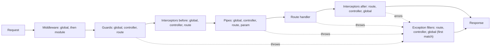

### 3.1 The Execution Chain Sequence

Understanding the exact order is what makes pipeline bugs debuggable:

1. **Middleware**: global (`app.use()`) first, then module middleware registered in `configure()`, in registration order.
2. **Guards**: global, then controller, then route. The first guard that returns `false` or throws stops the request.
3. **Interceptors (before `next.handle()`)**: global, then controller, then route.
4. **Pipes**: global, then controller, then route, then parameter-level pipes, for each argument in turn.
5. **Route handler**.
6. **Interceptors (after)**: in reverse, route, then controller, then global, because each interceptor wraps the next one's Observable.
7. **Exception filters**: route, then controller, then global. Unlike the other layers they do **not** chain: the first filter whose `@Catch()` matches the exception handles it, and the rest never run.

| Layer | Interface | Can see | Can stop the request | Can change the response |
| --- | --- | --- | --- | --- |
| Middleware | `NestMiddleware.use(req, res, next)` | Raw request/response; no handler metadata | Yes (by not calling `next()` or throwing) | Yes, but crudely |
| Guard | `CanActivate.canActivate(ctx)` | `ExecutionContext`: handler, class, metadata | Yes: return `false` (403) or throw | No |
| Interceptor | `NestInterceptor.intercept(ctx, next)` | `ExecutionContext` + handler result stream | Yes (return without calling `next.handle()`, e.g. a cache hit) | Yes: map, replace, time out |
| Pipe | `PipeTransform.transform(value, metadata)` | One argument value and its metadata | Yes: throw | Changes the argument, not the response |
| Filter | `ExceptionFilter.catch(exception, host)` | The exception and `ArgumentsHost` | n/a (runs after failure) | Yes: writes the error response |

Errors thrown in middleware reach **global** filters only, because middleware runs before Nest knows which controller will handle the request.

### 3.2 Middleware

Middleware is Express- or Fastify-style code that runs before routing to a handler. Use it for concerns that need the raw request and do not care which handler runs: correlation IDs, raw-body capture for webhook signatures, legacy Express middleware. The starter's request-ID middleware:

```typescript
import { Injectable, NestMiddleware } from '@nestjs/common';
import type { NextFunction, Request, Response } from 'express';
import { randomUUID } from 'node:crypto';

const VALID_ID = /^[\w-]{8,64}$/;

/** Reuses a caller's x-request-id when it looks sane, otherwise mints one, and echoes it back. */
@Injectable()
export class RequestIdMiddleware implements NestMiddleware {
  use(req: Request, res: Response, next: NextFunction): void {
    const incoming = req.header('x-request-id');
    const id = incoming && VALID_ID.test(incoming) ? incoming : randomUUID();
    req.headers['x-request-id'] = id;
    res.setHeader('x-request-id', id);
    next();
  }
}
```

It is bound in the module, which lets it use DI:

```typescript
import { MiddlewareConsumer, Module, NestModule, RequestMethod } from '@nestjs/common';
import { RequestIdMiddleware } from './common/middleware/request-id.middleware.js';

@Module({})
export class AppModule implements NestModule {
  configure(consumer: MiddlewareConsumer): void {
    consumer
      .apply(RequestIdMiddleware)
      .exclude({ path: 'health', method: RequestMethod.GET }) // example exclusion
      .forRoutes('{*splat}'); // Express 5 named wildcard; '*' is converted with a warning
  }
}
```

| Line / API | Role | What happens at runtime |
| :--- | :--- | :--- |
| `VALID_ID` check | Input hygiene | A caller cannot inject a 10 KB header or log-forging characters into your logs. |
| `req.headers['x-request-id'] = id` | Propagation | Later layers (the filter, loggers) read one consistent ID. |
| `res.setHeader(...)` before `next()` | Echo | Headers must be set before the body is written; doing it first is safe for every outcome. |
| `consumer.apply(...).forRoutes(...)` | Binding | Applied at startup for the matching routes; `forRoutes(TasksController)` would scope it to one controller. |
| `.exclude(...)` | Exemptions | In 12.2+, exclusions follow the router's case and trailing-slash rules. |

A functional middleware (`(req, res, next) => {...}`) is enough when no dependencies are needed; `app.use(fn)` in `main.ts` registers one globally, before any module middleware.

### 3.3 Guards and Reflector Metadata

A guard answers one question: may this request reach the handler? It receives an `ExecutionContext`, which, unlike middleware, knows the target class and method, so it can read metadata set by decorators. Returning `false` produces a 403 `ForbiddenException`; throwing lets you choose the status (401 for "who are you?", 403 for "not allowed").

The starter combines a global guard with an opt-out decorator. `Reflector.createDecorator()` (v10.2+) produces a typed decorator that is also its own metadata key:

```typescript
// src/common/decorators/public.decorator.ts
import { Reflector } from '@nestjs/core';

export const Public = Reflector.createDecorator<void, boolean>({ transform: () => true });
```

```typescript
// src/common/guards/api-key.guard.ts
import {
  CanActivate,
  ExecutionContext,
  Injectable,
  Logger,
  UnauthorizedException,
} from '@nestjs/common';
import { ConfigService } from '@nestjs/config';
import { Reflector } from '@nestjs/core';
import type { Request } from 'express';
import { timingSafeEqual } from 'node:crypto';
import { Public } from '../decorators/public.decorator.js';

@Injectable()
export class ApiKeyGuard implements CanActivate {
  private readonly logger = new Logger(ApiKeyGuard.name);

  constructor(
    private readonly reflector: Reflector,
    private readonly config: ConfigService,
  ) {}

  canActivate(context: ExecutionContext): boolean {
    const isPublic = this.reflector.getAllAndOverride(Public, [
      context.getHandler(),
      context.getClass(),
    ]);
    if (isPublic) return true;

    const expected = this.config.get<string>('app.apiKey');
    if (!expected) {
      this.logger.warn('API_KEY is not set; rejecting every protected request');
      throw new UnauthorizedException('API key authentication is not configured');
    }

    const request = context.switchToHttp().getRequest<Request>();
    const provided = request.header('x-api-key') ?? '';
    if (!safeEqual(provided, expected)) {
      throw new UnauthorizedException('Missing or invalid x-api-key header');
    }
    return true;
  }
}

function safeEqual(a: string, b: string): boolean {
  const left = Buffer.from(a);
  const right = Buffer.from(b);
  return left.length === right.length && timingSafeEqual(left, right);
}
```

| Line / API | Role | What happens at runtime |
| :--- | :--- | :--- |
| `getAllAndOverride(Public, [handler, class])` | Metadata lookup | Checks the method first, then the class; the first defined value wins. |
| `if (!expected) throw` | Fail closed | A missing secret rejects requests instead of letting everyone in. |
| `switchToHttp().getRequest<Request>()` | Protocol access | Typed access to the Express request for HTTP; other protocols use `switchToWs()` / `switchToRpc()`. |
| `timingSafeEqual` with a length check | Constant-time compare | `===` returns early at the first different byte, which leaks key prefixes through timing. |
| `throw new UnauthorizedException(...)` | 401 instead of 403 | The filter turns it into a problem document. |

Role-based access with the same pattern. `getAllAndOverride` lets a method-level `@Roles()` replace a class-level one; `getAllAndMerge` would combine them:

```typescript
import { Injectable, CanActivate, ExecutionContext } from '@nestjs/common';
import { Reflector } from '@nestjs/core';

export enum Role {
  USER = 'user',
  ADMIN = 'admin',
  SYSTEM = 'system',
}

export const Roles = Reflector.createDecorator<Role[]>();

@Injectable()
export class RolesGuard implements CanActivate {
  constructor(private readonly reflector: Reflector) {}

  canActivate(context: ExecutionContext): boolean {
    const requiredRoles = this.reflector.getAllAndOverride(Roles, [
      context.getHandler(),
      context.getClass(),
    ]);

    if (!requiredRoles || requiredRoles.length === 0) {
      return true; // No roles required
    }

    // request.user is set by an authentication guard that ran earlier (Stage 5).
    const { user } = context.switchToHttp().getRequest();
    return requiredRoles.some((role) => user?.roles?.includes(role));
  }
}

// usage: @Roles([Role.ADMIN]) on a controller or handler
```

Older code uses `SetMetadata('roles', roles)` with a string key and `reflector.get<string[]>('roles', ...)`. It still works; `createDecorator()` removes the string constant and types the value.

Guard order matters when you have several: register authentication before authorisation (`{ provide: APP_GUARD, useClass: JwtAuthGuard }` listed before `RolesGuard`), because `RolesGuard` needs `request.user`.

### 3.4 Pipes and Validation

A pipe transforms or validates one handler argument. Built-in pipes cover the common conversions:

| Pipe | Input | Output / error |
| --- | --- | --- |
| `ParseIntPipe`, `ParseFloatPipe` | `'42'` | `42`; `'abc'` gives `400 Validation failed (numeric string is expected)` |
| `ParseBoolPipe` | `'true'` / `'false'` | boolean |
| `ParseUUIDPipe({ version: '4' })` | UUID string | Same string, or 400 |
| `ParseEnumPipe(Status)` | `'open'` | enum value |
| `ParseArrayPipe({ items: Number, separator: ',' })` | `'1,2,3'` | `[1, 2, 3]` |
| `ParseDatePipe` (v11+) | ISO string | `Date` |
| `DefaultValuePipe(10)` | `undefined` | `10` (place before a `Parse*` pipe) |
| `ValidationPipe` | Plain object | DTO class instance, or 400 with every violation |
| `StandardSchemaValidationPipe` (v12) | Any value | Schema output, or 400 |

Each `Parse*` pipe accepts `{ optional: true }` so a missing value passes through as `undefined`, which the starter uses for `?done=`.

**DTO validation with class-validator.** A DTO is a class whose decorators describe the valid shape. Because it is a class, it exists at runtime, and `ValidationPipe` can find it through the parameter's metadata:

```typescript
// src/tasks/dto/create-task.dto.ts
import { Transform } from 'class-transformer';
import { IsIn, IsNotEmpty, IsOptional, IsString, MaxLength } from 'class-validator';
import { TASK_PRIORITIES, type TaskPriority } from '../task.entity.js';

export class CreateTaskDto {
  // Trim before validating, so "   " is rejected by IsNotEmpty.
  @Transform(({ value }) => (typeof value === 'string' ? value.trim() : value))
  @IsString()
  @IsNotEmpty()
  @MaxLength(120)
  title: string;

  @IsOptional()
  @IsIn(TASK_PRIORITIES)
  priority?: TaskPriority;
}
```

The starter registers the pipe globally:

```typescript
import { ValidationPipe } from '@nestjs/common';
import { APP_PIPE } from '@nestjs/core';

export const validationPipeProvider = {
  provide: APP_PIPE,
  useValue: new ValidationPipe({
    whitelist: true,
    forbidNonWhitelisted: true,
    transform: true,
  }),
};
```

| Option | Effect | Why it matters |
| --- | --- | --- |
| `whitelist: true` | Strips properties that have no validation decorator | Stops mass assignment: `{"title":"x","isAdmin":true}` cannot reach the service with `isAdmin`. |
| `forbidNonWhitelisted: true` | Rejects them with 400 instead of stripping | Clients learn about typos (`"titel"`) instead of silently losing data. |
| `transform: true` | Returns a DTO instance and converts primitive params by their TS type | `@Transform` runs; `@Param('id') id: number` would be converted even without `ParseIntPipe`. |
| `transformOptions: { enableImplicitConversion: true }` | Converts by declared property type | Handy for query DTOs; it can surprise you (`'false'` becomes `true` for a boolean). Prefer explicit `@Type()`/`@Transform()`. |
| `stopAtFirstError: true` | One message per property | Shorter errors. |
| `disableErrorMessages: true` | Hides details | For public APIs where validation messages leak schema details. |
| `exceptionFactory: (errors) => ...` | Custom error shape | Map to your own error codes. |

What the client sees for `{"title":"   ","priority":"urgent","isAdmin":true}` (asserted in `test/app.e2e-spec.ts`):

```json
{
  "type": "about:blank",
  "title": "Bad Request",
  "status": 400,
  "instance": "/tasks",
  "detail": [
    "property isAdmin should not exist",
    "title should not be empty",
    "priority must be one of the following values: low, medium, high"
  ]
}
```

**Standard Schema validation (v12).** When the team already has Zod, Valibot or ArkType schemas (shared with a frontend, for example), pass them to the parameter decorator instead of writing a DTO class:

```typescript
import { Body, Controller, Post, StandardSchemaValidationPipe, UsePipes } from '@nestjs/common';
import { z } from 'zod';

const createTaskSchema = z.object({
  title: z.string().trim().min(1).max(120),
  priority: z.enum(['low', 'medium', 'high']).default('medium'),
});
type CreateTaskInput = z.infer<typeof createTaskSchema>;

@Controller('v2/tasks')
@UsePipes(new StandardSchemaValidationPipe())
export class TasksV2Controller {
  @Post()
  create(@Body({ schema: createTaskSchema }) input: CreateTaskInput) {
    return input; // trimmed, defaulted, typed
  }
}
```

| | `ValidationPipe` + class-validator | `StandardSchemaValidationPipe` |
| --- | --- | --- |
| Schema lives in | Decorated classes | Schema objects (`z.object(...)`) |
| Type source | The class itself | `z.infer<typeof schema>` |
| Unknown keys | `whitelist` / `forbidNonWhitelisted` | The schema's own policy (`z.object` strips; `z.strictObject` rejects) |
| Sharing with a frontend | Awkward (decorators, reflect-metadata) | Natural |
| OpenAPI generation | `@nestjs/swagger` reads DTO classes | Same schemas feed OpenAPI in v12 |
| Mixing | Both pipes can be registered; each validates only arguments it understands | |

**A custom pipe.** Pipes are providers, so they can inject services, for example to load an entity or reject a nonexistent ID:

```typescript
import { Injectable, NotFoundException, PipeTransform } from '@nestjs/common';
import type { Task } from '../tasks/task.entity.js';
import { TasksService } from '../tasks/tasks.service.js';

@Injectable()
export class TaskByIdPipe implements PipeTransform<number, Promise<Task>> {
  constructor(private readonly tasks: TasksService) {}

  async transform(id: number): Promise<Task> {
    const task = await this.tasks.findOne(id).catch(() => undefined);
    if (!task) throw new NotFoundException(`Task ${id} not found`);
    return task;
  }
}

// @Get(':id') show(@Param('id', ParseIntPipe, TaskByIdPipe) task: Task) { return task; }
```

### 3.5 Interceptors

An interceptor wraps the handler. Code before `next.handle()` runs on the way in; operators on the returned Observable run on the way out. That one shape covers timing, logging, caching, response mapping, timeouts and error translation.

The starter's timing interceptor:

```typescript
import { CallHandler, ExecutionContext, Injectable, NestInterceptor } from '@nestjs/common';
import type { Response } from 'express';
import { Observable } from 'rxjs';
import { tap } from 'rxjs/operators';

@Injectable()
export class TimingInterceptor implements NestInterceptor {
  intercept(context: ExecutionContext, next: CallHandler): Observable<unknown> {
    if (context.getType() !== 'http') return next.handle();

    const started = performance.now();
    const response = context.switchToHttp().getResponse<Response>();
    const stamp = (): void => {
      if (!response.headersSent) {
        response.setHeader('Server-Timing', `app;dur=${(performance.now() - started).toFixed(1)}`);
      }
    };

    // tap's next/error callbacks run before Nest writes the response (or the exception filter
    // runs), so the header still makes it onto the wire. finalize() would run too late.
    return next.handle().pipe(tap({ next: stamp, error: stamp }));
  }
}
```

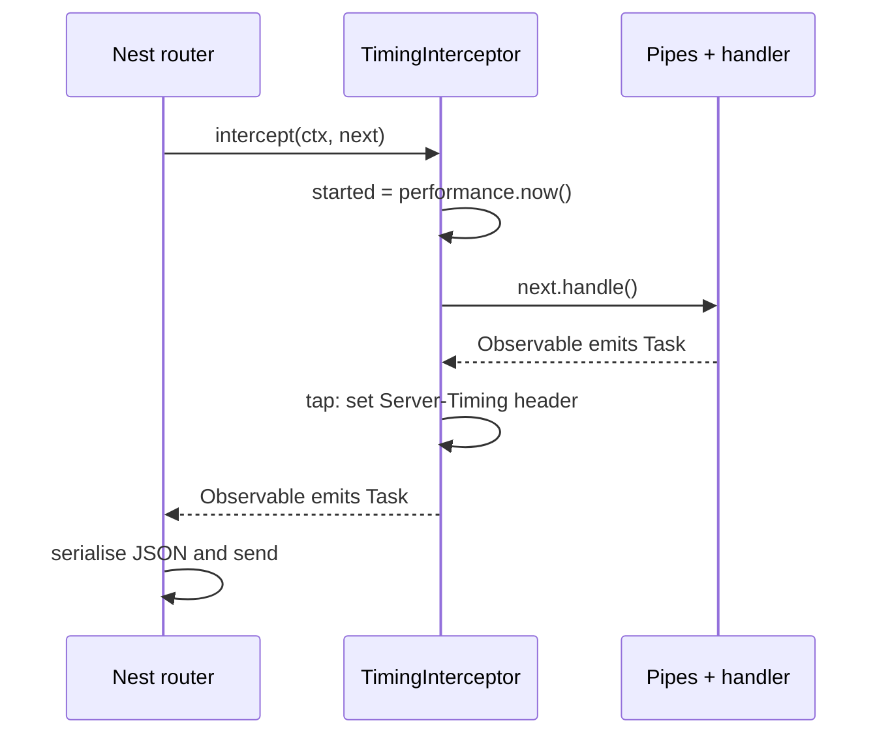

| Line / API | Role | What happens at runtime |
| :--- | :--- | :--- |
| `context.getType() !== 'http'` | Protocol guard | The same interceptor bound globally in a hybrid app also sees RPC and WebSocket calls. |
| `next.handle()` | Invoke the rest of the chain | Nothing downstream runs until the returned Observable is subscribed, which Nest does. Not calling it short-circuits the handler. |
| `tap({ next, error })` | Side effect without changing the value | Runs once per emission and on error. |
| `response.headersSent` | Safety check | A handler using `@Res()` may have already sent the response. |

A response envelope, as many API style guides require:

```typescript
import {
  Injectable,
  NestInterceptor,
  ExecutionContext,
  CallHandler,
} from '@nestjs/common';
import type { Response } from 'express';
import { Observable } from 'rxjs';
import { map } from 'rxjs/operators';

export interface StandardApiResponse<T> {
  statusCode: number;
  data: T;
  executionDurationMs: number;
  timestamp: string;
}

@Injectable()
export class ResponseTransformInterceptor<T>
  implements NestInterceptor<T, StandardApiResponse<T>>
{
  intercept(context: ExecutionContext, next: CallHandler<T>): Observable<StandardApiResponse<T>> {
    const start = Date.now();
    const response = context.switchToHttp().getResponse<Response>();

    return next.handle().pipe(
      map((data) => ({
        statusCode: response.statusCode,
        data,
        executionDurationMs: Date.now() - start,
        timestamp: new Date().toISOString(),
      })),
    );
  }
}
```

A timeout that turns slow handlers into a 504 instead of a hung socket:

```typescript
import {
  CallHandler,
  ExecutionContext,
  GatewayTimeoutException,
  Injectable,
  NestInterceptor,
} from '@nestjs/common';
import { Observable, TimeoutError, throwError } from 'rxjs';
import { catchError, timeout } from 'rxjs/operators';

@Injectable()
export class TimeoutInterceptor implements NestInterceptor {
  constructor(private readonly ms = 5_000) {}

  intercept(_context: ExecutionContext, next: CallHandler): Observable<unknown> {
    return next.handle().pipe(
      timeout(this.ms),
      catchError((err: unknown) =>
        throwError(() => (err instanceof TimeoutError ? new GatewayTimeoutException() : err)),
      ),
    );
  }
}
```

The timeout only stops waiting; the handler's Promise keeps running. Pass an `AbortSignal` down to `fetch` or the database driver if the work itself must stop.

### 3.6 Exception Filters and Problem Details (RFC 9457)

Without a custom filter, Nest's built-in filter answers `HttpException`s with `{ statusCode, message, error }` and anything else with a generic 500. A custom filter gives every error one documented shape. RFC 9457 (which obsoletes RFC 7807 and keeps its format) defines `application/problem+json` with `type`, `title`, `status`, `detail` and `instance`, plus any extension members. The starter's filter, abridged:

```typescript
import {
  ArgumentsHost,
  Catch,
  ExceptionFilter,
  HttpException,
  HttpStatus,
  Logger,
} from '@nestjs/common';
import type { Request, Response } from 'express';
import { STATUS_CODES } from 'node:http';

@Catch() // no argument: catch everything, including non-HTTP errors
export class ProblemDetailsFilter implements ExceptionFilter {
  private readonly logger = new Logger(ProblemDetailsFilter.name);

  catch(exception: unknown, host: ArgumentsHost): void {
    const http = host.switchToHttp();
    const request = http.getRequest<Request>();
    const response = http.getResponse<Response>();

    const status =
      exception instanceof HttpException ? exception.getStatus() : HttpStatus.INTERNAL_SERVER_ERROR;

    const problem: Record<string, unknown> = {
      type: 'about:blank', // RFC 9457: "no extra semantics beyond the status code"
      title: STATUS_CODES[status] ?? 'Error',
      status,
      instance: request.originalUrl,
      requestId: request.header('x-request-id'),
    };

    if (exception instanceof HttpException) {
      const body = exception.getResponse();
      if (typeof body === 'string') {
        problem.detail = body;
      } else {
        const { message, errorCode } = body as { message?: string | string[]; errorCode?: string };
        problem.detail = message;
        if (errorCode) problem.errorCode = errorCode; // v12 HttpExceptionOptions.errorCode
      }
    } else {
      // Never leak stack traces or driver messages to clients; log them instead.
      this.logger.error(exception instanceof Error ? exception.stack : String(exception));
      problem.detail = 'An unexpected error occurred';
    }

    response.status(status).type('application/problem+json').json(problem);
  }
}
```

| Line / API | Role | What happens at runtime |
| :--- | :--- | :--- |
| `@Catch()` | Exception type filter | Empty means all exceptions; `@Catch(HttpException)` or `@Catch(PrismaClientKnownRequestError)` narrows it. |
| `exception.getResponse()` | Original body | A string, or the object Nest built (`{ message, error, statusCode, errorCode? }`). |
| `STATUS_CODES[status]` | Title | Node's reason phrases: `Not Found`, `Unprocessable Entity`. |
| `type: 'about:blank'` | Problem type URI | Replace with documentation URLs (`https://api.example.com/problems/task-not-found`) once you have them. |
| `logger.error(stack)` for unknown errors | Observability | The client gets a generic 500; the log keeps the detail. |
| `.type('application/problem+json')` | Media type | Clients and gateways can recognise error documents without parsing. |

Throw meaningful exceptions from services and let the filter format them:

```typescript
import { ConflictException, NotFoundException } from '@nestjs/common';

throw new NotFoundException(`Task ${id} not found`, { errorCode: 'TASK_NOT_FOUND' });
throw new ConflictException('Title already used', {
  errorCode: 'TASK_DUPLICATE_TITLE',
  cause: dbError, // kept for logging, never serialised
});
```

To translate a library's errors (for example a unique-constraint violation) narrowly, write a filter for that class and extend `BaseExceptionFilter` so everything else keeps the default behaviour:

```typescript
import { ArgumentsHost, Catch, ConflictException } from '@nestjs/common';
import { BaseExceptionFilter } from '@nestjs/core';

class UniqueViolation extends Error {
  constructor(readonly constraint: string) {
    super(`unique violation on ${constraint}`);
  }
}

@Catch(UniqueViolation)
export class UniqueViolationFilter extends BaseExceptionFilter {
  catch(exception: UniqueViolation, host: ArgumentsHost): void {
    super.catch(
      new ConflictException(`Duplicate value for ${exception.constraint}`, {
        errorCode: 'DUPLICATE',
      }),
      host,
    );
  }
}
```

### 3.7 Custom Decorators

**Parameter decorators** extract request data without cluttering handler signatures:

```typescript
import { createParamDecorator, ExecutionContext } from '@nestjs/common';

export interface AuthenticatedUser {
  id: string;
  email: string;
  roles: string[];
}

export const CurrentUser = createParamDecorator(
  (data: keyof AuthenticatedUser | undefined, ctx: ExecutionContext) => {
    const request = ctx.switchToHttp().getRequest();
    const user: AuthenticatedUser = request.user;

    return data ? user?.[data] : user;
  },
);
```

Decorators combine with pipes directly in method signatures:

```typescript
import { Controller, Get, Param, ParseUUIDPipe } from '@nestjs/common';
import { type AuthenticatedUser, CurrentUser } from './current-user.decorator.js';

@Controller('users')
export class UserController {
  @Get(':id')
  async getUser(
    @Param('id', new ParseUUIDPipe({ version: '4' })) id: string,
    @CurrentUser() user: AuthenticatedUser,
  ) {
    return { id, requestedBy: user.id };
  }
}
```

`ValidationPipe` skips custom parameter decorators unless you set `validateCustomDecorators: true`, so `@CurrentUser() user: UserDto` is not validated by default.

**Decorator composition** bundles several decorators into one, keeping controllers readable and policies consistent:

```typescript
import { applyDecorators, HttpCode, HttpStatus, UseGuards } from '@nestjs/common';
import { Role, Roles, RolesGuard } from './roles.guard.js';

export function AdminAction() {
  return applyDecorators(Roles([Role.ADMIN]), UseGuards(RolesGuard), HttpCode(HttpStatus.OK));
}

// @AdminAction() @Post('reindex') reindex() {...}
```

### 3.8 ExecutionContext and ArgumentsHost Across Protocols

Nest components can run in HTTP controllers, WebSocket gateways and microservice handlers at the same time. `ArgumentsHost` gives access to the handler's arguments for whichever protocol is active; `ExecutionContext` extends it with `getClass()` and `getHandler()`, which guards and interceptors need for metadata.

```typescript
import { ArgumentsHost, Injectable } from '@nestjs/common';

@Injectable()
export class MultiProtocolInspector {
  inspect(host: ArgumentsHost): string {
    const type = host.getType(); // 'http' | 'ws' | 'rpc' (GraphQL adds 'graphql')

    if (type === 'http') {
      const req = host.switchToHttp().getRequest();
      return `[HTTP] ${req.method} ${req.url}`;
    }
    if (type === 'ws') {
      const client = host.switchToWs().getClient();
      return `[WS] client ${client.id}`;
    }
    const data = host.switchToRpc().getData();
    return `[RPC] payload ${JSON.stringify(data)}`;
  }
}
```

| Object | Available in | Adds |
| --- | --- | --- |
| `ArgumentsHost` | Exception filters | `getType()`, `getArgs()`, `switchToHttp()`, `switchToWs()`, `switchToRpc()` |
| `ExecutionContext` | Guards, interceptors, `createParamDecorator` | Everything above plus `getClass()` and `getHandler()` |
| `GqlExecutionContext.create(ctx)` | GraphQL resolvers (`@nestjs/graphql`) | `getContext()`, `getArgs()`, `getInfo()` |

### 3.9 Binding Scope: Global, Controller, Method and Parameter

Every enhancer can be bound at several levels:

| Level | Guards | Interceptors | Pipes | Filters |
| --- | --- | --- | --- | --- |
| Global via DI | `{ provide: APP_GUARD, useClass }` | `APP_INTERCEPTOR` | `APP_PIPE` | `APP_FILTER` |
| Global via app | `app.useGlobalGuards()` | `app.useGlobalInterceptors()` | `app.useGlobalPipes()` | `app.useGlobalFilters()` |
| Controller | `@UseGuards()` on the class | `@UseInterceptors()` | `@UsePipes()` | `@UseFilters()` |
| Method | `@UseGuards()` on the method | `@UseInterceptors()` | `@UsePipes()` | `@UseFilters()` |
| Parameter | n/a | n/a | `@Body(new ParseXPipe())` | n/a |

The starter uses the `APP_*` tokens. Compared with `app.useGlobal*()`:

| | `APP_*` provider in a module | `app.useGlobal*()` in `main.ts` |
| --- | --- | --- |
| Dependency injection | Yes: `ApiKeyGuard` injects `Reflector` and `ConfigService` | No: you construct it yourself with `new` |
| Active in `Test.createTestingModule({ imports: [AppModule] })` | Yes | No, unless the test repeats the call |
| Hybrid apps (HTTP + microservice) | Applies to all | Not applied to connected microservices or gateways by default |
| Where it is declared | Any module, still global | Only at bootstrap |

Pass a class (`@UseGuards(RolesGuard)`) rather than an instance (`@UseGuards(new RolesGuard())`) where possible: the class form lets Nest inject dependencies and reuse one instance.

### 3.10 End-to-End Testing the Pipeline with Supertest

Unit tests cover one class; the pipeline only exists when Nest assembles the app, so test it end to end. The starter's e2e test boots the real `AppModule` in memory (no port) and drives it with Supertest:

```typescript
import type { INestApplication } from '@nestjs/common';
import { Test } from '@nestjs/testing';
import request from 'supertest';
import type { App } from 'supertest/types.js';

const API_KEY = 'test-api-key-123';

describe('Starter API (e2e)', () => {
  let app: INestApplication<App>;
  let AppModule: unknown;

  beforeAll(async () => {
    // ConfigModule.forRoot() runs its load factories when app.module.ts is first evaluated,
    // so the variable must exist before that import. Static imports are hoisted, hence import().
    process.env.API_KEY = API_KEY;
    ({ AppModule } = await import('../src/app.module.js'));
  });

  beforeEach(async () => {
    const moduleRef = await Test.createTestingModule({ imports: [AppModule as never] }).compile();
    app = moduleRef.createNestApplication();
    await app.init(); // runs lifecycle hooks and registers routes; no listen() needed
  });

  afterEach(async () => {
    await app.close(); // runs shutdown hooks; fresh in-memory state per test
  });

  it('POST /tasks without a key is 401 problem+json', async () => {
    const res = await request(app.getHttpServer()).post('/tasks').send({ title: 'x' }).expect(401);

    expect(res.headers['content-type']).toContain('application/problem+json');
    expect(res.body).toMatchObject({ status: 401, title: 'Unauthorized', instance: '/tasks' });
  });
});
```

What the suite proves, layer by layer:

| Test | Layer exercised |
| --- | --- |
| `GET /health is public` | Middleware (`x-request-id`), interceptor (`Server-Timing`), `@Public()` guard bypass |
| `echoes a valid incoming x-request-id` | Middleware input validation |
| `POST /tasks without a key is 401` | Global guard + problem filter |
| `rejects unknown and invalid fields with 400` | `ValidationPipe` whitelist, `@Transform` trim, `@IsIn` |
| `full create, read, update, delete cycle` | Controller, service, repository, `@HttpCode(204)`, `errorCode` |
| `non-numeric id into 400` | `ParseIntPipe` |
| `unknown routes 404` | Router 404 through the global filter |

Run one file while developing: `npx vitest run test/app.e2e-spec.ts`, or `npx vitest` for watch mode.

### 3.11 Pitfalls

| Pitfall | Symptom | Fix |
| --- | --- | --- |
| `ValidationPipe` without `whitelist` | Extra fields such as `isAdmin` reach the service and the database (mass assignment) | `whitelist: true`, plus `forbidNonWhitelisted: true` for clear errors. |
| DTO declared as an `interface` or imported with `import type` | No validation at all; any body is accepted | DTOs must be classes with value imports. |
| Global pipe registered with `useGlobalPipes` only | e2e tests built from `AppModule` skip validation and pass when production would fail | Register with `APP_PIPE`. |
| Guard returns `false` for "not logged in" | Clients get 403 where 401 is correct; login redirects break | Throw `UnauthorizedException` for missing credentials, return `false`/403 for insufficient rights. |
| Guard needs `request.user` but runs before the auth guard | `Cannot read properties of undefined (reading 'roles')` | Order guards: authentication first, authorisation second. |
| Interceptor using `finalize()` to set headers | Header missing: `finalize` runs after the response was written | Use `tap({ next, error })`. |
| No `catchError` / error handling in a custom RxJS stream | Request hangs until the client times out | Return `throwError(() => err)` or let the error propagate; never swallow it into `EMPTY` without a response. |
| `@Res()` in a handler | Interceptors' `map` has no effect; Fastify migration breaks | Return values; use `@Res({ passthrough: true })` only to set headers. |
| Global filter catching everything and returning `exception.message` | Database errors and stack details leak to clients | Map known errors; log unknown ones and return a generic 500. |
| Expecting filters to chain | A route filter catches the error and the global filter never runs | Only the first matching filter runs; delegate with `super.catch()` from `BaseExceptionFilter`. |
| `forRoutes('*')` on Express 5 | Startup warning about legacy path syntax | `forRoutes('{*splat}')`. |
| `enableImplicitConversion` on boolean query params | `?done=false` becomes `true` | Use `ParseBoolPipe` or an explicit `@Transform`. |

### 3.12 Best Practices

- **Put each concern in its layer**: authentication in guards, validation in pipes, response shaping in interceptors, error formatting in one filter.
- **Register global enhancers as `APP_*` providers**: they get DI and they run in tests.
- **Validate everything that crosses the boundary**: body, params and query; `whitelist` + `forbidNonWhitelisted` by default.
- **Fail closed in guards**: missing configuration means "deny", never "allow".
- **Use `Reflector.createDecorator()` for metadata**: typed values and no shared string keys.
- **Return problem documents with stable `errorCode`s**: clients branch on codes, humans read `detail`.
- **Throw domain-specific HTTP exceptions from services sparingly**: in larger codebases, throw domain errors and map them in a filter so services stay transport-agnostic.
- **Keep interceptors protocol-aware**: check `context.getType()` when bound globally in hybrid apps.
- **Cover the pipeline with e2e tests**: unit tests cannot prove the order of guards, pipes and filters.

### 3.13 Hands-on Exercise

Add an audit trail: every successful `POST`, `PATCH` and `DELETE` on `/tasks` is recorded with the request ID, method, path and status, and `GET /audit` (protected by the API key) returns the last 50 entries.

1. Create `AuditModule` with an `AuditService` (in-memory ring buffer of 50 entries) and export it.
2. Write `AuditInterceptor` that skips `GET` requests, and on success (`tap({ next })`) records `{ requestId, method, path, status, at }`. Register it with `APP_INTERCEPTOR` in `AuditModule`.
3. Add `AuditController` with `GET /audit`.
4. Extend `test/app.e2e-spec.ts`: create a task, then expect `GET /audit` to contain one entry whose `requestId` equals the `x-request-id` response header of the create call.

Expected output:

```bash
$ curl -s localhost:8080/audit -H 'x-api-key: dev-key-change-me'
[{"requestId":"3f0c...","method":"POST","path":"/tasks","status":201,"at":"2026-11-03T10:15:02.114Z"}]
```

Solution sketch: copy the shape of `src/common/interceptors/timing.interceptor.ts` for the interceptor and `src/tasks/tasks.module.ts` for the module; failed requests must not be recorded, which the existing 401 and 400 tests let you assert.

[Back to top ⤴️](#-table-of-contents)

---

## 4. Stage 4: Data Layer: Prisma, TypeORM, Migrations & Transactions

This stage replaces the starter's in-memory repository with a real database and covers the persistence patterns NestJS teams rely on. It assumes Stages 2 and 3 (custom providers, lifecycle hooks, exception filters). Afterwards you can wire Prisma or TypeORM into the container, run migrations safely, and keep multi-step writes atomic.

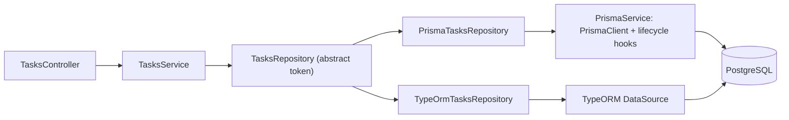

### 4.1 Prisma Integration via Service Lifecycle Hooks

Prisma generates a type-safe client from `schema.prisma`, so query results are typed from the schema. In NestJS the client becomes a provider that connects in `onModuleInit` and disconnects in `onModuleDestroy`:

```typescript
import { Injectable, OnModuleInit, OnModuleDestroy } from '@nestjs/common';
// Prisma 7's prisma-client generator writes the client to the output path set in schema.prisma;
// older projects import it from '@prisma/client'.
import { PrismaClient } from '../generated/prisma/client.js';

@Injectable()
export class PrismaService
  extends PrismaClient
  implements OnModuleInit, OnModuleDestroy
{
  async onModuleInit(): Promise<void> {
    await this.$connect();
  }

  async onModuleDestroy(): Promise<void> {
    await this.$disconnect();
  }
}
```

`onModuleDestroy` only runs on shutdown if `app.enableShutdownHooks()` was called (Stage 1.4).

### 4.2 Unit of Work and Transaction Management

Creating an order and decrementing inventory must succeed or fail together. Prisma's interactive transactions pass a transaction-bound client (`tx`) to a callback; every query on `tx` shares one connection and one transaction, and throwing inside the callback rolls everything back:

```typescript
import { Injectable } from '@nestjs/common';
import { PrismaService } from './prisma.service.js';

@Injectable()
export class OrderFulfillmentService {
  constructor(private readonly prisma: PrismaService) {}

  async createOrderWithLedger(userId: string, items: { sku: string; qty: number }[], amount: number) {
    return this.prisma.$transaction(async (tx) => {
      // 1. Decrement inventory
      for (const item of items) {
        const inventory = await tx.inventory.update({
          where: { sku: item.sku },
          data: { availableQty: { decrement: item.qty } },
        });

        if (inventory.availableQty < 0) {
          throw new Error(`Insufficient stock for SKU ${item.sku}`); // rolls back the decrement
        }
      }

      // 2. Insert order record
      return tx.order.create({
        data: {
          userId,
          totalAmount: amount,
          status: 'CONFIRMED',
        },
      });
    });
  }
}
```

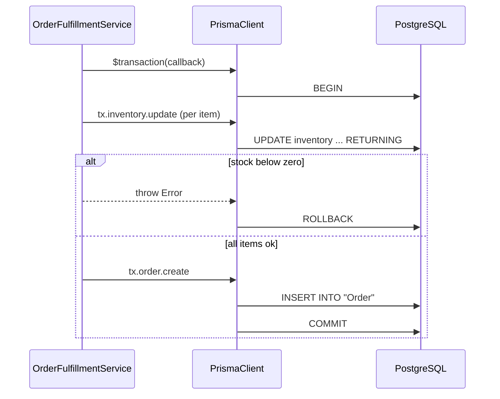

### 4.3 TypeORM Repositories

TypeORM maps decorated entity classes to tables and gives each entity a repository. `TypeOrmModule.forRootAsync()` configures the connection from `ConfigService`; `forFeature()` registers repositories for one module:

```typescript
import { Injectable, Module } from '@nestjs/common';
import { ConfigService } from '@nestjs/config';
import { InjectRepository, TypeOrmModule } from '@nestjs/typeorm';
import { Column, CreateDateColumn, Entity, PrimaryGeneratedColumn, Repository } from 'typeorm';

@Entity('tasks')
export class TaskEntity {
  @PrimaryGeneratedColumn()
  id: number;

  @Column({ length: 120 })
  title: string;

  @Column({ default: false })
  done: boolean;

  @CreateDateColumn({ type: 'timestamptz' })
  createdAt: Date;
}

@Injectable()
export class TypeOrmTasksStore {
  constructor(@InjectRepository(TaskEntity) private readonly repo: Repository<TaskEntity>) {}

  findOpen(): Promise<TaskEntity[]> {
    return this.repo.find({ where: { done: false }, order: { createdAt: 'DESC' } });
  }
}

@Module({
  imports: [
    TypeOrmModule.forRootAsync({
      inject: [ConfigService],
      useFactory: (config: ConfigService) => ({
        type: 'postgres',
        url: config.getOrThrow<string>('DATABASE_URL'),
        autoLoadEntities: true,
        synchronize: false, // never true in production: it can drop columns
      }),
    }),
    TypeOrmModule.forFeature([TaskEntity]),
  ],
  providers: [TypeOrmTasksStore],
})
export class PersistenceModule {}
```

### 4.4 Prisma vs TypeORM vs Drizzle vs MikroORM

| Concern | Prisma | TypeORM | Drizzle | MikroORM |
| --- | --- | --- | --- | --- |
| Schema source | `schema.prisma` | Decorated entity classes | TypeScript table definitions | Decorated entities or `defineEntity` |
| Types | Generated client | Entity classes | Inferred from tables | Entity classes |
| Migrations | `prisma migrate` | Generated from entity diff | `drizzle-kit` | Generated from entity diff |
| Unit of work / identity map | No | Partial | No | Yes |
| Nest integration | Custom `PrismaService` | `@nestjs/typeorm` | Custom provider | `@mikro-orm/nestjs` |
| Fit | Type-safe CRUD, fast onboarding | Existing TypeORM codebases | SQL-first teams | Rich domain models |

### 4.5 Pitfalls

| Pitfall | Symptom | Fix |
| --- | --- | --- |
| `synchronize: true` in production | Columns dropped or altered on deploy | Use migrations; `synchronize` only in throwaway local databases. |
| Using `this.prisma` instead of `tx` inside `$transaction` | Some writes commit even though the transaction rolled back | Use the callback's `tx` for every query. |
| Long transactions doing HTTP calls | Lock waits, `Transaction already closed` errors | Keep transactions short; do remote calls before or after. |
| One `PrismaClient` per request | `too many connections for role` | One singleton client per process. |

### 4.6 Best Practices

- **Keep the repository abstraction from Stage 2**: services stay ORM-agnostic and testable with the in-memory adapter.
- **Run migrations as a separate step**, not on application startup, so several replicas never race.
- **Map database errors to HTTP in one filter** (Stage 3.6), not in every service.

### 4.7 Hands-on Exercise

Implement `PrismaTasksRepository extends TasksRepository` against PostgreSQL, register it for `TASKS_STORE=prisma`, and make the existing `test/app.e2e-spec.ts` pass against a database started with `docker run -e POSTGRES_PASSWORD=dev -p 5432:5432 postgres:17`. Solution location: a new `src/tasks/prisma-tasks.repository.ts`.

[Back to top ⤴️](#-table-of-contents)

---

## 5. Stage 5: Security, Authentication, Authorization & Testing

This stage turns the starter's API-key guard into user authentication, adds fine-grained authorisation and abuse protection, and organises the test suite into layers. It assumes Stage 3's guards and decorators. Afterwards you can issue and verify JWTs, express "users may edit only their own orders" as policy, rate-limit endpoints and harden HTTP responses.

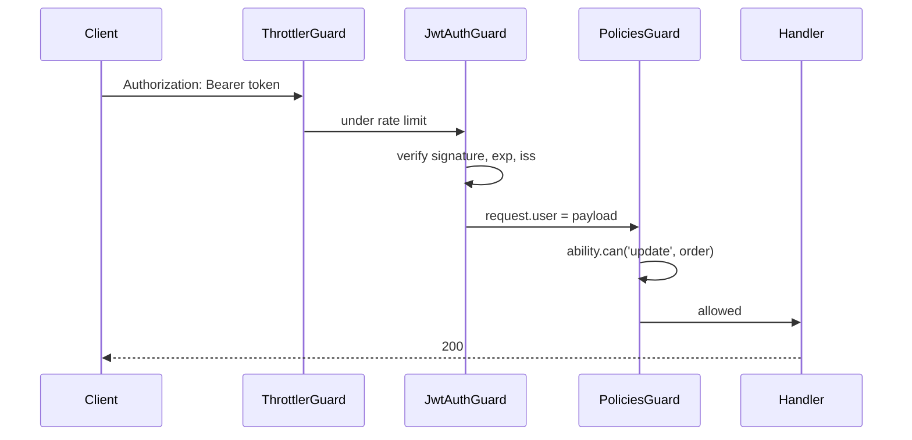

### 5.1 JWT Bearer Strategy with Passport.js

```typescript
import { Injectable, UnauthorizedException } from '@nestjs/common';
import { PassportStrategy } from '@nestjs/passport';
import { ExtractJwt, Strategy } from 'passport-jwt';
import { ConfigService } from '@nestjs/config';

export interface JwtPayload {
  sub: string;
  email: string;
  roles: string[];
}

@Injectable()
export class JwtStrategy extends PassportStrategy(Strategy) {
  constructor(configService: ConfigService) {
    super({
      jwtFromRequest: ExtractJwt.fromAuthHeaderAsBearerToken(),
      ignoreExpiration: false,
      // getOrThrow: a missing secret must stop startup. Never fall back to a hard-coded default.
      secretOrKey: configService.getOrThrow<string>('JWT_SECRET'),
    });
  }

  async validate(payload: JwtPayload) {
    if (!payload.sub) {
      throw new UnauthorizedException('Invalid token credentials');
    }
    // The return value becomes request.user.
    return { id: payload.sub, email: payload.email, roles: payload.roles };
  }
}
```

### 5.2 Attribute-Based Access Control (ABAC) with CASL

Roles answer "what kind of user is this?"; policies answer "may this user do this to this record?". CASL expresses the latter:

```typescript
import { AbilityBuilder, createMongoAbility, MongoAbility } from '@casl/ability';
import { Injectable } from '@nestjs/common';

export type Action = 'manage' | 'create' | 'read' | 'update' | 'delete';
export type AppAbility = MongoAbility<[Action, any]>;

@Injectable()
export class CaslAbilityFactory {
  createForUser(user: { id: string; isAdmin: boolean }): AppAbility {
    const { can, cannot, build } = new AbilityBuilder<AppAbility>(createMongoAbility);

    if (user.isAdmin) {
      can('manage', 'all');
    } else {
      can('read', 'Order');
      can('update', 'Order', { customerId: user.id }); // condition on the record's fields
      cannot('delete', 'Order');
    }

    return build();
  }
}
```

### 5.3 Rate Limiting via `@nestjs/throttler`

Protect public APIs against brute force and accidental floods. Several named limits apply at once; `ttl` is in milliseconds:

```typescript
import { Module } from '@nestjs/common';
import { ThrottlerModule, ThrottlerGuard } from '@nestjs/throttler';
import { APP_GUARD } from '@nestjs/core';

@Module({
  imports: [
    ThrottlerModule.forRoot([
      { name: 'short', ttl: 1000, limit: 3 }, // 3 requests per second
      { name: 'medium', ttl: 10000, limit: 20 }, // 20 requests per 10 seconds
    ]),
  ],
  providers: [{ provide: APP_GUARD, useClass: ThrottlerGuard }],
})
export class SecurityModule {}
```

The default storage is in memory, so each replica counts separately; use a Redis-backed storage behind a load balancer.

### 5.4 HTTP Hardening Built into NestJS 12

```typescript
import { NestFactory } from '@nestjs/core';
import { AppModule } from './app.module.js';

const app = await NestFactory.create(AppModule);
app.useSecurityHeaders(); // CSP, HSTS, nosniff, frame options; removes X-Powered-By
app.enableCsrfProtection(); // 12.1+: for cookie-authenticated browser clients
app.enableCors({ origin: ['https://app.example.com'], credentials: true });
await app.listen(8080, '0.0.0.0');
```

### 5.5 Test Layers

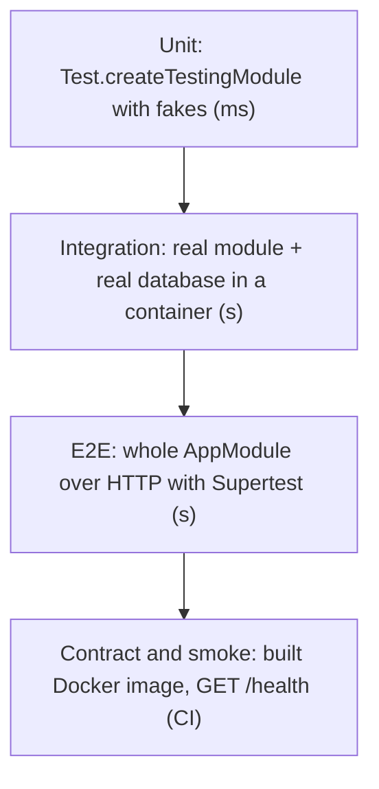

| Layer | Starter example | What it catches |
| --- | --- | --- |
| Unit | `src/tasks/tasks.service.spec.ts`, `src/common/guards/api-key.guard.spec.ts` | Business rules, guard logic |
| E2E | `test/app.e2e-spec.ts` | Pipeline order, validation, status codes |
| Smoke | `docker` job in `.github/workflows/ci.yml` | Port, `0.0.0.0` binding, ESM runtime image |

### 5.6 Pitfalls

| Pitfall | Symptom | Fix |
| --- | --- | --- |
| Hard-coded fallback JWT secret | Anyone who reads the source can mint tokens | `getOrThrow('JWT_SECRET')`; validate length at startup. |
| `ignoreExpiration: true` | Stolen tokens work forever | Keep `false`; use short access tokens and refresh tokens. |
| In-memory throttler behind several replicas | Limits multiplied by replica count | Shared Redis storage. |
| `cors: { origin: '*' }` with credentials | Browsers reject the response, or any site can call the API | Explicit origin list. |

### 5.7 Best Practices

- **Authenticate globally, opt out with `@Public()`**: new endpoints are protected by default.
- **Authorise on the record, not only the role**: CASL conditions or explicit ownership checks in the service.
- **Keep secrets out of images and logs**: inject them as environment variables at runtime.

### 5.8 Hands-on Exercise

Replace `ApiKeyGuard` with `JwtAuthGuard` plus a `POST /auth/token` endpoint that issues tokens for a seeded user, and protect `PATCH /tasks/:id` so only the task's owner may change it. Expected: a second user's token gets `403` with `errorCode: "TASK_NOT_OWNER"`. Solution location: a new `src/auth/` module.

[Back to top ⤴️](#-table-of-contents)

---

## 6. Stage 6: Real-time, Queues, Performance & Deployment

This stage covers what happens after the API works: pushing events to clients, moving slow work to queues, switching HTTP adapters, structured logs and shipping the container. It assumes Stages 1-5. Afterwards you can run a NestJS service in production with predictable latency and clean shutdowns.

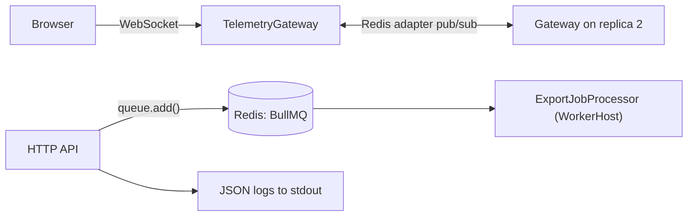

### 6.1 Scalable WebSockets with Socket.io and the Redis Adapter

```typescript
import {
  WebSocketGateway,
  WebSocketServer,
  SubscribeMessage,
  MessageBody,
  ConnectedSocket,
} from '@nestjs/websockets';
import { Server, Socket } from 'socket.io';

// List real origins; '*' lets any website open a socket with your users' cookies.
@WebSocketGateway({ cors: { origin: ['https://app.example.com'] }, namespace: 'telemetry' })
export class TelemetryGateway {
  @WebSocketServer()
  server: Server;

  @SubscribeMessage('subscribe_market')
  handleJoinRoom(@MessageBody() symbol: string, @ConnectedSocket() client: Socket) {
    client.join(`market:${symbol}`);
    client.emit('subscribed', { status: 'OK', room: `market:${symbol}` });
  }

  broadcastPriceUpdate(symbol: string, price: number) {
    this.server.to(`market:${symbol}`).emit('price_tick', { symbol, price, ts: Date.now() });
  }
}
```

With more than one replica, a room only contains sockets connected to that process; the Socket.IO Redis adapter fans `emit` out to every replica.

### 6.2 High-Performance BullMQ Task Queuing

For heavy tasks (PDF generation, media transcoding, batch exports), BullMQ moves execution to workers that pull jobs from Redis:

```typescript
import { Injectable } from '@nestjs/common';
import { Job, Queue } from 'bullmq';
import { InjectQueue, Processor, WorkerHost } from '@nestjs/bullmq';

export const EXPORT_QUEUE = 'export-jobs';

@Injectable()
export class ReportSchedulerService {
  constructor(@InjectQueue(EXPORT_QUEUE) private readonly exportQueue: Queue) {}

  async scheduleCsvExport(reportId: string, filterCriteria: Record<string, unknown>) {
    return this.exportQueue.add(
      'generate-csv',
      { reportId, filterCriteria },
      {
        jobId: `export:${reportId}`, // idempotent: a second add with the same id is ignored
        attempts: 3,
        backoff: { type: 'exponential', delay: 2000 },
        removeOnComplete: 1000,
        removeOnFail: 5000,
      },
    );
  }
}

@Processor(EXPORT_QUEUE)
export class ExportJobProcessor extends WorkerHost {
  async process(job: Job<{ reportId: string }>): Promise<string> {
    // Intensive CSV generation logic...
    return `https://s3.internal/exports/${job.data.reportId}.csv`;
  }
}
```

### 6.3 Switching to the Fastify Adapter

NestJS uses Express by default. Fastify usually serves more requests per second for small JSON payloads because of its schema-based serialisation and lighter routing; measure your own workload before switching, because real handlers often spend most of their time in the database:

```typescript
import { NestFactory } from '@nestjs/core';
import { FastifyAdapter, NestFastifyApplication } from '@nestjs/platform-fastify';
import { AppModule } from './app.module.js';

const app = await NestFactory.create<NestFastifyApplication>(
  AppModule,
  new FastifyAdapter({ logger: false }),
);

await app.listen(8080, '0.0.0.0'); // Fastify defaults to 127.0.0.1, so the host matters even more
```

### 6.4 Structured JSON Logging

Use structured logs in production so Loki, Elasticsearch or Datadog can filter by field. Since v11 the built-in logger can emit JSON, and since v12 extra objects become fields of the same record:

```typescript
import { ConsoleLogger } from '@nestjs/common';
import { NestFactory } from '@nestjs/core';
import { AppModule } from './app.module.js';

const app = await NestFactory.create(AppModule, {
  logger: new ConsoleLogger({ json: true, colors: false }),
});
```

`nestjs-pino` is the common alternative when you want per-request child loggers and automatic request logs:

```typescript
import { Module } from '@nestjs/common';
import { LoggerModule } from 'nestjs-pino';

@Module({
  imports: [
    LoggerModule.forRoot({
      pinoHttp: {
        level: process.env.NODE_ENV === 'production' ? 'info' : 'debug',
        transport: process.env.NODE_ENV !== 'production' ? { target: 'pino-pretty' } : undefined,
      },
    }),
  ],
})
export class ObservabilityModule {}
```

### 6.5 The Production Container

The repository's `Dockerfile` has three stages: `deps` (production `node_modules`), `build` (`npm ci` plus `nest build`) and `runtime` (`node:24-alpine`, the `node` user, `EXPOSE 8080`, a `HEALTHCHECK` on `/health`, `CMD ["node", "dist/main.js"]`). CI builds it and curls `/health` from the running container.

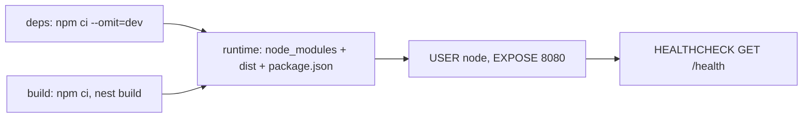

### 6.6 Pitfalls

| Pitfall | Symptom | Fix |
| --- | --- | --- |
| Unbounded BullMQ queues | Redis memory exhausted: `OOM command not allowed when used memory > 'maxmemory'` | `removeOnComplete`, `removeOnFail`, `attempts` with backoff. |
| CPU-heavy work in handlers | Event loop blocked, p99 latency explodes for all requests | Worker threads or a queue. |
| `res.status().send()` in handlers | Breaks Fastify portability and interceptors | Return values; use `@HttpCode()`. |
| No shutdown hooks | In-flight jobs and requests cut on deploy | `enableShutdownHooks()`; BullMQ workers close in `onModuleDestroy`. |

### 6.7 Best Practices

- **Stateless replicas**: sessions, rate limits, socket rooms and queues live in Redis, not in process memory.
- **Health endpoint without dependencies** for liveness, and a separate readiness check that pings the database.
- **Log JSON to stdout**: let the platform ship logs.

### 6.8 Hands-on Exercise

Add a `POST /tasks/export` endpoint that enqueues a BullMQ job and returns `202 Accepted` with the job ID, plus a processor that writes `exports/<jobId>.json`. Expected: calling it twice with the same `Idempotency-Key` header returns the same job ID. Solution location: a new `src/exports/` module.

[Back to top ⤴️](#-table-of-contents)

---

## M1. Masterclass: Inside the DI Container: Scanner, Injector & Module Graph

What happens between `NestFactory.create()` and the first request, and why that knowledge explains most "can't resolve dependencies" errors.

### M1.1 How It Works Internally

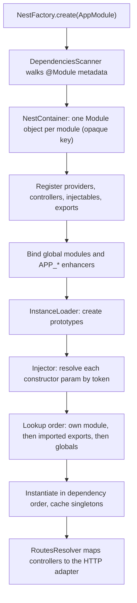

The scanner reads metadata only; it creates nothing. Each module gets an opaque key (v11 made key generation cheaper, which shortened bootstrap for large graphs). The injector resolves a token by looking in the requesting module, then in the exports of imported modules, then in global modules. If none has it, you get the familiar error, which names the class, shows `?` at the failing index and lists the module context it searched.

### M1.2 Worked Example: Reading the Error Message

```text
Nest can't resolve dependencies of the ReportsService (?). Please make sure that the argument
TasksService at index [0] is available in the ReportsModule context.
```

| Fragment | Meaning | Usual fix |
| --- | --- | --- |
| `ReportsService (?)` | Parameter 0 could not be resolved | Look at that constructor parameter. |
| `argument TasksService` | The token the injector searched for | If it says `Object` or `Function`, the type was an interface or `import type`. |
| `ReportsModule context` | Where it searched | Import the module that **exports** `TasksService`. |

### M1.3 Trade-offs: Ways to Get an Instance

| Technique | Resolved | Cost | Use for |
| --- | --- | --- | --- |
| Constructor injection | At startup | None per request | Almost everything. |
| `ModuleRef.get(Token)` | On call | Map lookup | Breaking cycles, plugin registries. |
| `ModuleRef.resolve(Token)` | On call, scoped | New instance per context | Request-scoped or transient providers. |
| `ModuleRef.create(Class)` | On call | Full instantiation | Dynamically chosen strategies. |
| `LazyModuleLoader.load(() => import(...))` | On first use | Module bootstrap at runtime | Serverless cold-start reduction. |

### M1.4 Production Checklist

- [ ] No `Scope.REQUEST` providers on hot paths without a measured reason.
- [ ] No `forwardRef()` left without a ticket to remove the cycle.
- [ ] Startup time measured (`NestFactory.create` to `listen`), especially for serverless.
- [ ] `abortOnError: false` in tests so bootstrap errors surface as exceptions.

[Back to top ⤴️](#-table-of-contents)

---

## M2. Masterclass: Event-Driven Architecture, CQRS & Sagas

`@nestjs/cqrs` splits writes (commands), reads (queries) and reactions (events) into separate handlers connected by buses.

### M2.1 How It Works Internally

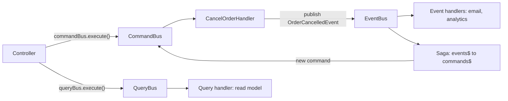

### M2.2 Commands

```typescript
import { CommandHandler, ICommandHandler } from '@nestjs/cqrs';

export class CancelOrderCommand {
  constructor(
    public readonly orderId: string,
    public readonly reason: string,
  ) {}
}

@CommandHandler(CancelOrderCommand)
export class CancelOrderHandler implements ICommandHandler<CancelOrderCommand> {
  async execute(command: CancelOrderCommand): Promise<{ status: string }> {
    // Load the aggregate, apply the change, persist, publish domain events.
    return { status: `CANCELLED: ${command.reason}` };
  }
}
```

### M2.3 Sagas with RxJS Operators

A saga listens to the event stream and maps events to new commands, coordinating multi-step workflows without the steps knowing about each other:

```typescript
import { Injectable } from '@nestjs/common';
import { Saga, ICommand, ofType } from '@nestjs/cqrs';
import { Observable } from 'rxjs';
import { map, delay } from 'rxjs/operators';

export class OrderCreatedEvent {
  constructor(
    public readonly orderId: string,
    public readonly userId: string,
  ) {}
}

export class SendWelcomeEmailCommand implements ICommand {
  constructor(public readonly userId: string) {}
}

@Injectable()
export class OrderSagas {
  @Saga()
  orderCreated = (events$: Observable<any>): Observable<ICommand> => {
    return events$.pipe(
      ofType(OrderCreatedEvent),
      delay(500), // Delay notification
      map((event) => new SendWelcomeEmailCommand(event.userId)),
    );
  };
}
```

### M2.4 Trade-offs

| Approach | Coupling | Consistency | Operational cost |
| --- | --- | --- | --- |
| Direct service calls | High | Immediate | Lowest |
| `@nestjs/event-emitter` | Low, in-process | Immediate, lost on crash | Low |
| `@nestjs/cqrs` buses | Low, in-process | Immediate, lost on crash | Medium (more classes) |
| Outbox table + message broker | Lowest, cross-service | Eventual, durable | Highest |

### M2.5 Production Checklist

- [ ] In-process events that must not be lost are written to an outbox in the same transaction.
- [ ] Saga steps are idempotent (they may run twice after a retry).
- [ ] Saga streams handle errors; one thrown error must not kill the subscription.

[Back to top ⤴️](#-table-of-contents)

---

## M3. Masterclass: Microservices, Transports & Hybrid Applications

### M3.1 How It Works Internally

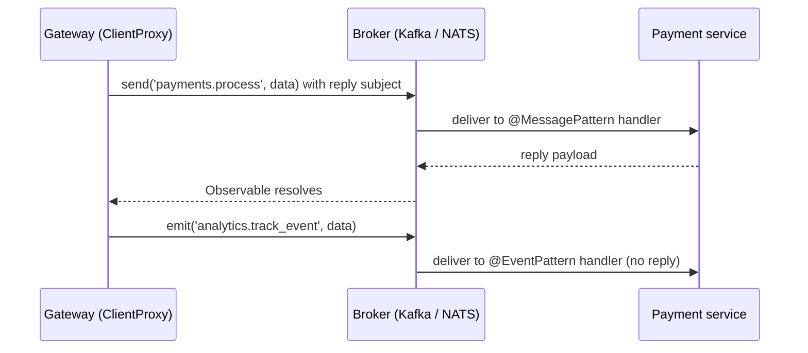

### M3.2 Hybrid Applications (HTTP + Message Consumer)

A single NestJS process can expose REST and consume from a broker:

```typescript
import { NestFactory } from '@nestjs/core';
import { Transport, MicroserviceOptions } from '@nestjs/microservices';
import { AppModule } from './app.module.js';

const app = await NestFactory.create(AppModule);

app.connectMicroservice<MicroserviceOptions>({
  transport: Transport.KAFKA,
  options: {
    client: { brokers: ['kafka.internal:9092'] },
    consumer: { groupId: 'order-consumer-cluster' },
  },
});

// Start the microservice listeners, then the HTTP server
await app.startAllMicroservices();
await app.listen(8080, '0.0.0.0');
```

### M3.3 Event Pattern vs Message Pattern

- **`@MessagePattern('topic')`**: request-response. The client awaits a reply.
- **`@EventPattern('topic')`**: fire-and-forget. No reply; since 12.2, event handlers that reply to `send()` on TCP, Redis, NATS, MQTT and RabbitMQ log a deprecation warning.

```typescript
import { Controller } from '@nestjs/common';
import { MessagePattern, EventPattern, Payload } from '@nestjs/microservices';

@Controller()
export class PaymentMessageController {
  @MessagePattern('payments.process')
  handlePaymentRequest(@Payload() data: { orderId: string; amount: number }) {
    return { transactionId: `TX-${data.orderId}`, authorized: true };
  }

  @EventPattern('analytics.track_event')
  handleAnalyticsEvent(@Payload() event: { name: string; timestamp: number }) {
    // record the metric; nothing is returned to the producer
  }
}
```

### M3.4 Transport Trade-offs

| Transport | Delivery | Ordering | Good for |
| --- | --- | --- | --- |
| TCP | At most once | Per connection | Internal RPC in small systems |
| Redis pub/sub | At most once | None | Lightweight notifications |
| NATS (v12: `@nats-io/transport-node`) | At most once (core), at least once (JetStream) | Per subject | Low-latency RPC and events |
| RabbitMQ | At least once with acks | Per queue | Work queues, routing |
| Kafka | At least once, replayable | Per partition | Event streams, high volume |
| gRPC | Request-response, streaming | Per stream | Typed service-to-service APIs |

### M3.5 Production Checklist

- [ ] Every consumer is idempotent.
- [ ] Message contracts are versioned and shared as a package.
- [ ] Timeouts on every `send()` (`timeout()` operator).
- [ ] Global pipes and filters registered with `APP_*` so they also cover microservice handlers.

[Back to top ⤴️](#-table-of-contents)

---

## M4. Masterclass: The NestJS 12 Toolchain: ESM, Standard Schema, Vitest & oxlint

### M4.1 How It Works Internally

```mermaid
flowchart LR
    TS["src/*.ts"] -->|"nest build (tsc, nodenext)"| JS["dist/*.js ESM"]
    TS -->|"vitest (Vite 8, Oxc transform)"| T["tests with decorator metadata"]
    TS -->|"oxlint --type-aware (tsgolint)"| L["lint diagnostics"]
    JS -->|"node, type: module"| RUN["running app"]
    CJS["CommonJS app"] -->|"require(esm), Node 22.12+"| NEST["@nestjs/* ESM packages"]
```

### M4.2 Worked Example

This repository is the worked example: `package.json` (`"type": "module"`), `tsconfig.json` (`nodenext`), `vitest.config.ts`, `.oxlintrc.json` and `.js` relative imports throughout `src/`. Run `npm run lint && npm run typecheck && npm test && npm run build`.

### M4.3 Trade-offs

| Choice | Pros | Cons |
| --- | --- | --- |
| ESM | Matches the ecosystem, top-level await, ESM-only libraries | `.js` imports, `__dirname` replacement |
| CommonJS on v12 | No code changes | Relies on `require(esm)`; new templates and docs assume ESM |
| Vitest | Fast, watch mode, Jest-compatible API | Different mock API (`vi`) |
| Jest | Existing suites and plugins | ESM support still needs flags |
| oxlint | Very fast, type-aware rules | Fewer plugins than ESLint |

### M4.4 Production Checklist

- [ ] Runtime image contains `package.json` with `"type": "module"`.
- [ ] CI runs `tsc --noEmit` in addition to tests (Vitest strips types without checking them).
- [ ] Node version pinned to 22.12+ or 24 in `engines`, CI and Docker.

[Back to top ⤴️](#-table-of-contents)

---

## M5. Masterclass: Flagship Blueprint: Resilient Order Management Service

An end-to-end order service that combines validation pipes, guards, DTOs, domain errors and exception filters from the stages above.

### M5.1 How It Works Internally

```mermaid
flowchart TD
    C["POST /api/v1/orders"] --> G["JwtAuthGuard + ThrottlerGuard"]
    G --> V["ValidationPipe: CreateOrderDto"]
    V --> OC["OrderController"]
    OC --> OS["OrderService"]
    OS --> TX["Prisma $transaction: stock + order"]
    TX --> OB["Outbox row: OrderCreated"]
    OB --> K["Relay to Kafka"]
    OS -. NotFound / Conflict .-> F["ProblemDetailsFilter"]
```

### M5.2 Core Controller, DTO and Service

```typescript
import {
  Body,
  Controller,
  Get,
  HttpCode,
  HttpStatus,
  Injectable,
  NotFoundException,
  Param,
  Post,
} from '@nestjs/common';
import { IsInt, IsNotEmpty, IsString, Min } from 'class-validator';

// 1. Data Transfer Object (DTO)
export class CreateOrderDto {
  @IsString()
  @IsNotEmpty()
  readonly customerId: string;

  @IsInt()
  @Min(1)
  readonly amountCents: number; // integer minor units, never floats for money
}

interface Order {
  id: string;
  customerId: string;
  amountCents: number;
  status: 'CREATED';
}

// 2. Domain Service
@Injectable()
export class OrderService {
  private readonly orders = new Map<string, Order>();

  async create(dto: CreateOrderDto): Promise<Order> {
    const order: Order = {
      id: crypto.randomUUID(),
      customerId: dto.customerId,
      amountCents: dto.amountCents,
      status: 'CREATED',
    };
    this.orders.set(order.id, order);
    return order;
  }

  async findById(orderId: string): Promise<Order> {
    const order = this.orders.get(orderId);
    if (!order) {
      // An HttpException, not a bare Error: a bare Error would become a 500.
      throw new NotFoundException(`Order ${orderId} not found`, { errorCode: 'ORDER_NOT_FOUND' });
    }
    return order;
  }
}

// 3. Controller (validation comes from the global APP_PIPE ValidationPipe)
@Controller('api/v1/orders')
export class OrderController {
  constructor(private readonly orderService: OrderService) {}

  @Post()
  @HttpCode(HttpStatus.CREATED)
  createOrder(@Body() dto: CreateOrderDto) {
    return this.orderService.create(dto);
  }

  @Get(':id')
  getOrder(@Param('id') id: string) {
    return this.orderService.findById(id);
  }
}
```

### M5.3 Trade-offs

| Decision | Chosen | Alternative | Why |
| --- | --- | --- | --- |
| Event publication | Transactional outbox | Publish after commit | No lost events if the process dies between commit and publish. |
| Money | Integer minor units | `number` floats | `0.1 + 0.2` rounding errors. |
| IDs | UUID v7 / random UUID | Sequential integers | No enumeration; safe across shards. |

### M5.4 Production Checklist

- [ ] Idempotency keys on `POST /orders`.
- [ ] Problem documents with stable `errorCode`s.
- [ ] Outbox relay monitored for lag.
- [ ] Readiness probe checks the database; liveness does not.

[Back to top ⤴️](#-table-of-contents)

---

## 7. Stage 7: Staff NestJS Backend Engineer Interview Handbook & Cheatsheet

### 7.1 Core Concepts (Q1-Q10)

#### Q1. What is the exact execution order of NestJS request lifecycle components?

1. **Middleware** runs first, at the HTTP adapter level (Express or Fastify): global `app.use()` middleware, then module middleware from `configure()`.
2. **Guards** evaluate `canActivate()` (global, controller, route) for authentication and authorisation.
3. **Interceptors (before the handler)** start timers, open tracing spans, or short-circuit with a cached value.
4. **Pipes** validate and transform each argument (`body`, `query`, `param`) using DTOs or schemas.
5. **The route handler** calls the domain service.
6. **Interceptors (after the handler)** transform the outgoing value with RxJS operators (`map`, `tap`, `timeout`), in reverse binding order.
7. **Exception filters** run only when something throws; the first filter whose `@Catch()` matches (route, then controller, then global) writes the error response.

The diagram and binding tables are in [Stage 3.1](#31-the-execution-chain-sequence).

#### Q2. What is the difference between `ExecutionContext` and `ArgumentsHost`?

`ArgumentsHost` gives access to a handler's arguments regardless of protocol through `switchToHttp()`, `switchToWs()` and `switchToRpc()`, plus `getType()` to tell them apart; exception filters receive it. `ExecutionContext` extends it with `getClass()` (the controller class) and `getHandler()` (the method), which guards and interceptors need to read decorator metadata through `Reflector`.

#### Q3. What is the purpose of `Reflector` in NestJS?

`Reflector` reads metadata attached to classes and methods by decorators. Guards and interceptors call `reflector.getAllAndOverride(Decorator, [context.getHandler(), context.getClass()])` so that method-level metadata overrides class-level metadata, or `getAllAndMerge()` to combine both. `Reflector.createDecorator()` (v10.2+) creates a typed decorator that is also the lookup key, which replaces `SetMetadata('roles', ...)` with a string constant.

#### Q4. How do dynamic modules differ from static modules?

A static module declares fixed `providers`, `controllers`, `imports` and `exports` in `@Module({...})`. A dynamic module is returned at runtime from a static method (`forRoot()`, `register()`, `forRootAsync()`) as a `DynamicModule` object, so it can build providers from options, including options produced by an async factory that injects `ConfigService`. `ConfigurableModuleBuilder` generates these methods with correct typing ([Stage 2.7](#27-dynamic-modules-forroot-forrootasync-and-configurablemodulebuilder)).

#### Q5. What does `{ whitelist: true, forbidNonWhitelisted: true }` do in `ValidationPipe`?

`whitelist: true` strips every property that has no class-validator decorator on the target DTO, which prevents mass assignment (a client adding `isAdmin: true`). `forbidNonWhitelisted: true` rejects such requests with `400 Bad Request` and a message per unknown property instead of silently stripping them, so client typos surface immediately.

#### Q6. What is the role of an exception filter?

A filter catches exceptions thrown anywhere in the pipeline and writes the error response. Implementing `ExceptionFilter` with `@Catch()` lets you map error types to status codes and emit one consistent format, such as RFC 9457 problem details (`application/problem+json`). Filters do not chain: only the first matching one runs, so narrow filters should extend `BaseExceptionFilter` and delegate.

#### Q7. What is the difference between `@MessagePattern` and `@EventPattern`?

`@MessagePattern('topic')` implements request-response: the client calls `send()` and gets an Observable of the handler's return value. `@EventPattern('topic')` implements fire-and-forget: the producer calls `emit()` and does not wait. Since 12.2, an event handler that answers `send()` on TCP, Redis, NATS, MQTT or RabbitMQ logs a deprecation warning, because the next major will stop sending such replies.

#### Q8. How does NestJS resolve circular dependencies between services?

With `forwardRef()` on both sides of the injection:

```typescript
@Inject(forwardRef(() => OtherService))
private readonly otherService: OtherService
```

`forwardRef()` wraps the class reference in a function, so it is read only after both classes have been defined. Modules use `imports: [forwardRef(() => OtherModule)]`. A cycle is a design smell; extract the shared logic or replace one direction with events ([Stage 2.6](#26-resolving-circular-dependencies-via-forwardref)).

#### Q9. How does NestJS achieve platform independence between Express and Fastify?

Through the adapter pattern: `AbstractHttpAdapter` defines routing, request/response access and server lifecycle, and `ExpressAdapter`, `FastifyAdapter` and (12.3+) the native Node adapter implement it. Decorators such as `@Get()`, `@Body()` and `@Param()` talk to the abstraction. Passing `new FastifyAdapter()` to `NestFactory.create()` moves the app to Fastify without changing controllers, as long as handlers return values rather than calling Express APIs through `@Res()`.

#### Q10. How do you handle database transactions with Prisma in NestJS?

Inject a `PrismaService` and use the interactive transaction API, `prisma.$transaction(async (tx) => { ... })`. Every query inside must use `tx`, which is bound to one connection and one transaction; throwing inside the callback rolls back. Keep transactions short and free of network calls to other services ([Stage 4.2](#42-unit-of-work-and-transaction-management)).

### 7.2 Internals & Performance (Q11-Q15)

#### Q11. Why should you avoid `Scope.REQUEST` whenever possible?

`Scope.REQUEST` creates a new instance of the provider for every request, and the scope bubbles up: every provider and controller that depends on it, directly or indirectly, also becomes request-scoped. Under heavy load that means tens of thousands of short-lived objects per second, more garbage-collection work and higher tail latency. Pass request data as method arguments, use `AsyncLocalStorage` for context, or use durable providers keyed by tenant when per-tenant state is the real need.

#### Q12. Why use structured JSON logging (Pino or `ConsoleLogger({ json: true })`) instead of the default text logger?

The default `ConsoleLogger` prints coloured, human-readable lines, which log aggregators must parse with fragile patterns. Structured JSON gives every field (level, context, request ID, latency, error stack) its own key, so Elasticsearch, Loki or Datadog can index and filter it. Since v11 the built-in logger can emit JSON (`new ConsoleLogger({ json: true })`) and since v12 extra objects become `params` of the same record; `nestjs-pino` adds automatic per-request logging and child loggers carrying the request ID.

#### Q13. How does BullMQ prevent duplicate job execution?

A job added with an explicit `jobId` is unique within its queue: adding another job with the same ID while the first still exists does not create a second job, so retries of the producing request do not charge a card twice. For guarantees beyond that window, make the processor idempotent too (for example a unique constraint on the side effect it writes).

#### Q14. How do sagas work in `@nestjs/cqrs`?

A saga is a method decorated with `@Saga()` that receives the `EventBus` stream as an Observable and returns an Observable of commands. It filters with `ofType(SomeEvent)`, can delay, buffer or combine events with RxJS operators, and maps them to commands that the `CommandBus` dispatches. This coordinates multi-step workflows without the steps importing each other; the steps must be idempotent because a saga may re-run after failures.

#### Q15. How can a single NestJS process function as a hybrid application?

Call `app.connectMicroservice<MicroserviceOptions>({ transport, options })` on an HTTP application, then `await app.startAllMicroservices()` before `app.listen()`. The process then serves REST traffic and consumes from a broker (Kafka, NATS, RabbitMQ) at the same time. Global enhancers registered with `app.useGlobal*()` do not apply to the connected microservices by default (pass `inheritAppConfig: true`), while `APP_*` providers do.

### 7.5 Staff Cheatsheet

| Need | NestJS answer | Gotcha |
| --- | --- | --- |
| Share a provider across modules | `exports: [Service]` + import the module | Re-listing it in `providers` creates a second instance. |
| Inject by contract | Abstract class token, or `Symbol` + `@Inject()` | Interfaces are erased at runtime. |
| Configure a library module | `ConfigurableModuleBuilder` | Use `forRoot` for app-wide, `register` for per-import. |
| Validate input | `APP_PIPE` with `ValidationPipe({ whitelist, forbidNonWhitelisted, transform })` | DTOs must be classes with value imports. |
| Validate with Zod | `@Body({ schema })` + `StandardSchemaValidationPipe` (v12) | The decorator only attaches metadata; register the pipe. |
| Opt out of global auth | `Reflector.createDecorator()` + `getAllAndOverride` | Fail closed when the secret is missing. |
| Consistent errors | `@Catch()` filter emitting `application/problem+json` | Filters do not chain. |
| Stable error codes | `new NotFoundException(msg, { errorCode })` (v12) | Older versions need a custom body. |
| Match everything (Express 5) | `forRoutes('{*splat}')` | Bare `'*'` is legacy syntax. |
| Graceful shutdown | `app.enableShutdownHooks()` | Off by default. |
| Container networking | `app.listen(port, '0.0.0.0')` | `localhost` is unreachable from outside the container. |
| Faster builds | `nest build --builder swc` | Add `tsc --noEmit` in CI. |

[Back to top ⤴️](#-table-of-contents)

---

## 🧪 Example Projects

| Project | Builds on | What you practise | Stretch goal |
| --- | --- | --- | --- |
| [Starter tasks API](./src) (in this repo) | [Stage 1](#1-stage-1-setup-project-anatomy--bootstrap), [Stage 2](#2-stage-2-modules-controllers-providers--dependency-injection), [Stage 3](#3-stage-3-the-request-pipeline-middleware-guards-pipes-interceptors--filters) | Modules, custom providers, global guard/pipe/interceptor/filter, Vitest + Supertest | Complete the exercises in 1.11, 2.13 and 3.13. |
| URL shortener | Stages 2-4 | Prisma repository, unique constraints mapped to 409, redirects with `@Redirect()` | Click analytics through a BullMQ queue. |
| Multi-tenant notes API | Stages 2, 3, 5 | JWT auth, CASL ownership rules, `AsyncLocalStorage` tenant context | Durable providers per tenant. |
| Live auction | Stages 3, 6 | Socket.IO gateway, rooms, Redis adapter, guards on WebSocket events | Horizontal scaling across three replicas. |
| Report export service | Stages 4, 6 | BullMQ producer and processor, idempotent job IDs, file streaming with `StreamableFile` | Progress events over Server-Sent Events (`@Sse()`). |
| Order saga | [M2](#m2-masterclass-event-driven-architecture-cqrs--sagas), [M3](#m3-masterclass-microservices-transports--hybrid-applications) | Commands, events, a saga, Kafka transport, outbox table | Compensation steps for a failed payment. |
| Order management blueprint | [M5](#m5-masterclass-flagship-blueprint-resilient-order-management-service) | Everything: auth, validation, transactions, problem details, Docker | Deploy with readiness/liveness probes. |

## 📝 Cheat Sheets

### CLI / Commands

```bash
# Project
nest new my-api --strict --package-manager npm   # choose ESM when asked
nest info                                         # versions for bug reports
nest upgrade --dry-run                            # v11 -> v12 preview

# Generators (each registers itself in the nearest module)
nest g resource modules/orders                    # module, controller, service, DTOs, specs
nest g module modules/payments
nest g service modules/payments --no-spec
nest g controller modules/payments
nest g guard common/guards/auth
nest g interceptor common/interceptors/logging
nest g filter common/filters/http-exception
nest g pipe common/pipes/parse-cursor
nest g decorator common/decorators/roles
nest g middleware common/middleware/request-id
nest g resource orders --dry-run                  # show changes, write nothing

# Build and run
nest start --watch                                # dev
nest start --debug --watch                        # dev + inspector
nest build                                        # tsc
nest build --builder swc --type-check             # fast + type errors
node dist/main.js                                 # production

# Tests (this repo)
npm test                                          # vitest run
npx vitest                                        # watch
npm run test:cov                                  # coverage (v8)
npm run lint && npm run typecheck

# Common packages
npm i @nestjs/config class-validator class-transformer
npm i @nestjs/throttler @nestjs/passport passport passport-jwt @nestjs/jwt
npm i @nestjs/bullmq bullmq nestjs-pino pino-http
npm i @nestjs/platform-fastify
npm i @nestjs/cqrs @nestjs/microservices
```

### Decorator and API Quick Reference

| Task | Code |
| --- | --- |
| Route prefix / verb | `@Controller('tasks')`, `@Get(':id')`, `@Post()`, `@Patch(':id')`, `@Delete(':id')` |
| Path param as number | `@Param('id', ParseIntPipe) id: number` |
| Optional query flag | `@Query('done', new ParseBoolPipe({ optional: true })) done?: boolean` |
| Default value | `@Query('limit', new DefaultValuePipe(20), ParseIntPipe) limit: number` |
| Body DTO | `@Body() dto: CreateTaskDto` |
| Status code | `@HttpCode(HttpStatus.NO_CONTENT)` |
| Response header | `@Header('Cache-Control', 'no-store')` |
| Redirect | `@Redirect('https://example.com', 301)` |
| Bind guard / interceptor / pipe / filter | `@UseGuards(X)`, `@UseInterceptors(X)`, `@UsePipes(X)`, `@UseFilters(X)` |
| Global enhancer with DI | `{ provide: APP_GUARD, useClass: X }` (also `APP_PIPE`, `APP_INTERCEPTOR`, `APP_FILTER`) |
| Metadata decorator | `export const Roles = Reflector.createDecorator<string[]>()` |
| Read metadata | `reflector.getAllAndOverride(Roles, [ctx.getHandler(), ctx.getClass()])` |
| Param decorator | `createParamDecorator((data, ctx) => ctx.switchToHttp().getRequest().user)` |
| Compose decorators | `applyDecorators(Roles(['admin']), UseGuards(RolesGuard))` |
| Value provider | `{ provide: CLOCK, useValue: () => new Date() }` |
| Factory provider | `{ provide: DB, inject: [ConfigService], useFactory: async (c) => connect(c) }` |
| Inject by token | `@Inject(CLOCK) private readonly now: Clock` |
| Config namespace | `registerAs('app', () => ({ port: Number(process.env.PORT) }))` |
| Test override | `Test.createTestingModule({ imports: [M] }).overrideProvider(T).useValue(x)` |

## 📚 Resources

- [NestJS documentation](https://docs.nestjs.com/)
- [NestJS migration guide](https://docs.nestjs.com/migration-guide)
- [NestJS releases and changelog](https://github.com/nestjs/nest/releases)
- [NestJS source repository](https://github.com/nestjs/nest)
- [Nest CLI repository](https://github.com/nestjs/nest-cli)
- [NestJS official blog (Trilon)](https://trilon.io/blog)
- [Standard Schema specification](https://standardschema.dev/)
- [RFC 9457: Problem Details for HTTP APIs](https://www.rfc-editor.org/rfc/rfc9457)
- [Express 5 migration guide](https://expressjs.com/en/guide/migrating-5.html)
- [Node.js release schedule](https://nodejs.org/en/about/previous-releases)

## 🤝 Contributing

Contributions are welcome. Read the [contributing guide](https://github.com/TheLearningHubOrg/.github/blob/main/CONTRIBUTING.md) and the [code of conduct](https://github.com/TheLearningHubOrg/.github/blob/main/CODE_OF_CONDUCT.md) before you open a pull request. Commit messages follow [Conventional Commits](https://www.conventionalcommits.org/), which drive the automated changelog.

Guide conventions: services default to singleton scope, every external input passes through a validation pipe, and microservice contracts are typed with `@MessagePattern()` and `@EventPattern()`.

## 📄 License

This project is licensed under the MIT License. See the [LICENSE](LICENSE) file for details.

## 🙏 Acknowledgments

- [NestJS](https://nestjs.com/) and its maintainers
- [Express](https://expressjs.com/) and [Fastify](https://fastify.dev/), the HTTP platforms underneath
- [class-validator](https://github.com/typestack/class-validator) and [class-transformer](https://github.com/typestack/class-transformer)
- [Vitest](https://vitest.dev/), [Supertest](https://github.com/forwardemail/supertest) and [oxlint](https://oxc.rs/), used by the starter project

## 🌐 Connect with me

- [Twitter](https://twitter.com/manthan_ank)
- [LinkedIn](https://www.linkedin.com/in/manthanank)
- [Facebook](https://www.facebook.com/manthanank/)
- [Instagram](https://www.instagram.com/manthan_ank/)
- [YouTube](https://www.youtube.com/@manthanank)
- [GitHub](https://github.com/manthanank)

## ☕ Support

If you like this learning repository and find it useful, consider buying me a coffee or sponsoring me through GitHub Sponsors. Your support helps me keep these guides up to date. Thank you!

[](https://www.buymeacoffee.com/manthanank)

[](https://github.com/sponsors/manthanank)

---

Show your support by 🌟 the repository.
